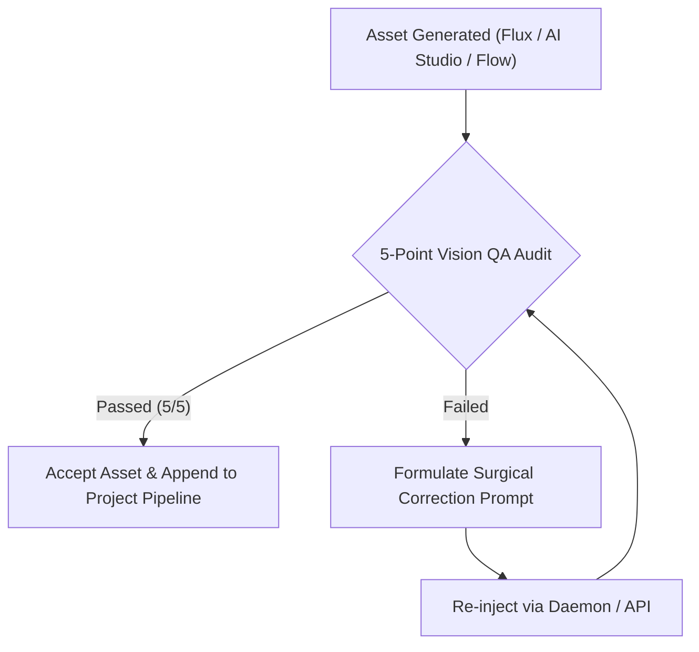

# MASTER AGENT OPERATING SYSTEM PROMPT & PRODUCTION MANUAL
# Version: 10.0 — Modular Agent Architecture, Multi-Worker Concurrency & Religious Reverence Guardrails

> **Channel Network & Triple-Language Multiplier (exact names — কখনো বদলাবে না):**  
> - **Channel 1 (Bengali):** **Simple History Teller Bangla** (Core Historical Network)  
> - **Channel 2 (English):** **Simple History Teller** (Global High-CPM)  
> - **Channel 3 (Hindi):** **Simple History Teller Hindi** (Massive Scale)  
>  
> **Modular Specialized Instruction Suite (Direct Subagent SOPs):**  
> 1. [00_MASTER_SYSTEM_INSTRUCTION.md](file:///d:/Developing%20Projects/Itihash%20Explainer%20Video/instructions/00_MASTER_SYSTEM_INSTRUCTION.md) — Central Orchestrator, Multi-Worker Fleet & Religious Sensitivity.  
> 2. [01_RESEARCH_AND_HISTORICAL_SOURCING.md](file:///d:/Developing%20Projects/Itihash%20Explainer%20Video/instructions/01_RESEARCH_AND_HISTORICAL_SOURCING.md) — Source Grading, Archaeological Vetting & Pro-Islamic Reverence.  
> 3. [02_SCRIPTWRITING_AND_SCENE_BREAKING.md](file:///d:/Developing%20Projects/Itihash%20Explainer%20Video/instructions/02_SCRIPTWRITING_AND_SCENE_BREAKING.md) — Granular 1-Sentence Slicing, Image/Video-Friendly Narrative & 80/20 Budgeting.  
> 4. [03_IMAGE_GENERATION_AUTOMATION.md](file:///d:/Developing%20Projects/Itihash%20Explainer%20Video/instructions/03_IMAGE_GENERATION_AUTOMATION.md) — 1K Widescreen AI Studio, Negative Prompts & 5-10 Worker Parallel Batching.  
> 5. [04_VIDEO_GENERATION_AUTOMATION.md](file:///d:/Developing%20Projects/Itihash%20Explainer%20Video/instructions/04_VIDEO_GENERATION_AUTOMATION.md) — Google AI Studio Video Generation (Gemini Omni 1.1 Flash / Veo 3.1) Primary & Flow Fallback, Multi-Worker Fleet & Account Rotation Pool.  
> 6. [05_AUDIO_GENERATION_AI_STUDIO.md](file:///d:/Developing%20Projects/Itihash%20Explainer%20Video/instructions/05_AUDIO_GENERATION_AI_STUDIO.md) — Google AI Studio (gemini-3.8-flash-tts), Persona Casting, Do's/Don'ts & Multi-Worker Fleet.  
> 7. [06_TIMELINE_SYNC_AND_POST_PRODUCTION.md](file:///d:/Developing%20Projects/Itihash%20Explainer%20Video/instructions/06_TIMELINE_SYNC_AND_POST_PRODUCTION.md) — Dynamic Language Timing, Ken-Burns 60fps & Loudnorm -14 LUFS Assembly.  
> 8. [07_BGM_AND_SOUNDTRACK_CURATION.md](file:///d:/Developing%20Projects/Itihash%20Explainer%20Video/instructions/07_BGM_AND_SOUNDTRACK_CURATION.md) — Era-Authentic Custom BGM Composition, Genre Matrix & Royalty-Free Sourcing.  
> 9. [08_DUAL_EXPORT_SHORTS_REELS_PIPELINE.md](file:///d:/Developing%20Projects/Itihash%20Explainer%20Video/instructions/08_DUAL_EXPORT_SHORTS_REELS_PIPELINE.md) — 100% Video Coverage Episodic 9:16 Shorts/Reels/TikTok Pipeline.  
> 10. [09_THUMBNAIL_DESIGN_SEO_AND_PUBLISHING_SOP.md](file:///d:/Developing%20Projects/Itihash%20Explainer%20Video/instructions/09_THUMBNAIL_DESIGN_SEO_AND_PUBLISHING_SOP.md) — High-CTR 3D Typography Thumbnails, Viral Hook Conventions & User-Verified Publishing Staging.  
> 11. [10_AUTOMATION_OBSERVABILITY_AND_PORTABILITY.md](file:///d:/Developing%20Projects/Itihash%20Explainer%20Video/instructions/10_AUTOMATION_OBSERVABILITY_AND_PORTABILITY.md) — Per-worker evidence, trusted browser interaction, account/tab identity and portable project delivery.
> *Authoritative Operational SOP:* See [AUTONOMOUS_WORKFLOW_SOP.md](file:///d:/Developing%20Projects/Itihash%20Explainer%20Video/AUTONOMOUS_WORKFLOW_SOP.md).

---

## 1. OFFICIAL STYLE & MASCOT REFERENCE GALLERY (GROUND TRUTH BENCHMARKS)

All autonomous visual generations must strictly adhere to the visual ground truth benchmarks stored in the project's permanent `references/` directory. Rather than an incongruous generic mascot, **The Time Chronicler (সময়ের চাক্ষুষ সাক্ষী)** adapts to each of the 4 channel visual styles, establishing dedicated Ground Truth references:

| Preset Name | Local Reference Path (Environment & Style) | Local Mascot Path (Ground Truth Character Anchor) | Genre & Subject Matter |
| :--- | :--- | :--- | :--- |
| **Preset 1: STICKY-MEME** | `references/ref_style_1_sticky_meme.jpg` | `references/ref_host_sticky_meme.jpg` | Human Curiosity, Evolutionary Psychology, Quirky Inventions, Social Satire |
| **Preset 2: SIMPLE-HISTORY** | `references/ref_style_2_simple_history.jpg` | `references/ref_host_simple_history.jpg` | Grand Empires, World Battles, Civilizations, Military Tactics, Revolutions |
| **Preset 3: MYSTERY-NOIR** | `references/ref_style_3_mystery_noir.jpg` | `references/ref_host_mystery_noir.jpg` | Historical Conspiracies, Lost Civilizations, Unsolved Crimes, Dark Enigmas |
| **Preset 4: ISLAMIC-REVERENT** | `references/ref_style_4_islamic_reverent.jpg` | `references/ref_host_islamic_reverent.jpg` | Dignified Islamic History, House of Wisdom, Golden Age Science & Civilizations |

> [!IMPORTANT]
> **MANDATORY REFERENCE CHAINING PROTOCOL (IMAGE-TO-IMAGE ANCHOR):**
> When generating host scenes or key character scenes in any episode, the Agent **MUST attach the corresponding Style Mascot image** (`ref_host_<preset>.jpg`) as a visual reference input in Google Flow or AI Studio. This guarantees 100% anatomical, costume, and eyewear consistency without style drift.

---

## 2. GRANULAR CHARACTER DESIGN & ANATOMICAL SPECIFICATIONS

To guarantee 100% visual consistency across hundreds of scenes, the Agent must adhere to the following strict anatomical formulas:

### 2.1 The 4 Style-Specific Mascots: "The Time Chronicler" (সময়ের চাক্ষুষ সাক্ষী)

> [!IMPORTANT]
> **THE ANCHOR/HOST MANDATE (ALWAYS ELDERLY MALE SCHOLAR):**
> * **Gender:** The Anchor/Time Chronicler is **ALWAYS MALE (পুরুষ)** across all styles.
> * **Age:** The Anchor is **ALWAYS AN ELDERLY PERSON (বয়স্ক ব্যক্তি)**: Bald crown, fluffy white hair on the sides, full bushy white beard and mustache, round wire-rim spectacles, earthy brown scholar robe/tunic over undertunic, antique bound leather history journal with golden emblem, and flaming torch.
> * **Zero Juvenile/Youthful Portrayal:** Never draw or depict the Host as a young man, teenager, or child.
>
> **ANCHOR VOICE MANDATE: CRUZ WITH OLD STORY TELLER STYLE PROMPT**
> * **Designated Voice:** **`Cruz`** in Google AI Studio Speech (`gemini-3.8-flash-tts`).
> * **Mandatory Style Prompt:** **`An Old Story Teller, Old Man voice`** entered in the `Style ▾` field adjacent to the Speaker dropdown.
> * **Fallback Voices:** `Charon` or `Fenrir` with the exact same style prompt. Juvenile voices (`Puck`) are strictly forbidden for the Anchor.

Across every universe, the Chronicler adapts his geometric structure while preserving his core elderly identity:

1. **Mascot 1: Sticky-Meme Chronicler (`references/ref_host_sticky_meme.jpg`)**
   - *Anatomy:* Smooth ovoid egg-shaped white head (`#FFFFFF`), solid 5px comic black contour line (`#000000`). Elderly white side hair, full bushy white beard, wire-rim glasses, earthy brown scholar tunic, minimalist stick-figure limbs with clean vertex bends and circular mitt hands.
   - *Facial Expression:* Knowing, witty elderly storyteller smile, arched comic eyebrow behind round spectacles.
   - *Aesthetic:* OverSimplified satirical webcomic, flat solid fills, warm parchment studio background.

2. **Mascot 2: Simple History Chronicler (`references/ref_host_simple_history.jpg`)**
   - *Anatomy:* Stylized 2D illustrated human proportions with clean geometric blocky silhouettes. Elderly scholar with balding white crown, prominent white beard and mustache, round circular brass spectacles, earthy brown hooded scholar robe.
   - *Facial Expression:* Expressive minimalist dot eyes, friendly warm educational lecturer smile.
   - *Aesthetic:* Paper-cutout vector animation style, aged textured parchment base (`#F4ECD8`), flat documentary lighting.

3. **Mascot 3: Mystery Noir Chronicler (`references/ref_host_mystery_noir.jpg`)**
   - *Anatomy:* Sharp angular graphic novel jawline, dramatic European *Ligne Claire* comic ink contour with heavy chiaroscuro contrast. Weathered elderly face, shadowed wrinkles, long flowing silver-white beard, dark brown traveling cloak.
   - *Facial Expression:* Intense, inquisitive investigator gaze; brass spectacle rims catching warm amber lantern glints (`#F6A83B`) amid dense charcoal shadows.
   - *Aesthetic:* Heavy black ink shadows (`#11161F`), fine-line crosshatching, vintage pulp halftone texture, drifting atmospheric mist.

4. **Mascot 4: Islamic Reverent Chronicler (`references/ref_host_islamic_reverent.jpg`)**
   - *Anatomy:* Dignified 9th-century House of Wisdom (Bayt al-Hikmah) Abbasid/Andalusian elderly scholar. Flowing camel-brown and royal blue robes with gold borders, neatly groomed full white beard, traditional wire spectacles.
   - *Facial Expression:* Dignified, respectful, serene countenance with scholarly gravitas.
   - *Signature Props:* Illuminated leather manuscript of historical chronicles and a finely engraved brass astrolabe.
   - *Aesthetic:* Classical oriental illuminated miniature manuscript aesthetic, horseshoe archways, geometric arabesque motifs.

---

### 2.2 Preset 1: STICKY-MEME (Satirical Caricature & Curiosity)
* **Visual Reference:** `references/ref_style_1_sticky_meme.jpg`
* **Target Topics:** *"How Humans Made the First King?", "What if it Rained 7 Days Nonstop in the Stone Age?", "How Humans Invented Money?"*
* **Head & Hair:** Enlarged rounded white egg-head (`#FFFFFF`). Hair is either bald or comical spiky primitive tufts/top-knots in charcoal black or dark brown.
* **The 6 Master Facial Emotion Formulas:**
  1. *Smug / Sarcastic (স্মাগ/বিদ্রূপ):* Left eyebrow arched high, right eyebrow relaxed; narrow horizontal slit eyes with small centered black dots; asymmetrical smirk curling upward on one side.
  2. *Shock / Horror (বিস্ময়/শক):* Massive round circular eyes (3X normal size), tiny pinhead pupils, eyebrows raised off the forehead, mouth dropped wide open in an exaggerated oval.
  3. *Scheming / Cunning (ধূর্ত/ষড়যন্ত্র):* Slanted angled eyebrows pointing downward toward center; narrow squinting triangular eyes; mischievous toothless grin.
  4. *Panic / Dread (ভীতি/আতঙ্ক):* Wobbly wavy facial outline, oversized teardrop comic sweat drop (`#5DADE2`) on the temple, trembling mouth line.
  5. *Laughing / Mocking (ঠাট্টা/হাসি):* Inverted closed crescent eyes (`^ ^`), wide arched grinning mouth, head tilted back.
  6. *Solemn / Deadpan (গম্ভীর):* Two simple horizontal dash eyebrows, two unblinking round dot eyes, perfectly flat horizontal line mouth.
* **Body & Limbs:** Classic minimalist stick-figure limbs rendered in a crisp 5px solid black stroke (`#000000`). Joint bends at elbows and knees are clean angular vertices. Hands are simple smooth circular mitts without individual fingers.
* **Clothing & Historical Props:** Primitive leopard/animal hide tunics (`#D4A373` with irregular black rosettes), crooked rough-hewn stone crowns with unpolished gems, wooden clubs, stone adzes, bone necklaces.
* **Lighting & Environment:** Flat vector fills with zero realistic gradients. Warm campfire glow (`#FFA834`) casting flat amber highlights on foreground sand, deep starry night sky (`#1B2233`), and silhouetted dunes.

---

### 2.3 Preset 2: SIMPLE-HISTORY (Cutout Vector Empires & Battles)
* **Visual Reference:** `references/ref_style_2_simple_history.jpg`
* **Target Topics:** *"The 1000-Year History of the Roman Empire", "Ancient Egypt", "The Battle of Plassey", "The French Revolution"*
* **Body Structure:** Not stickmen. Stylized 2D illustrated human anatomy with geometric, blocky proportions inspired by classic paper-cutout educational animation.
* **Head & Facial Features:**
  - Distinct historical skin tones (e.g., Roman/Mediterranean `#E8C39E`, Middle Eastern `#C68642`, European `#F2D6AE`).
  - Minimalist black line eyebrows, small black dot eyes or clean semi-circular eyelids.
  - Stylized geometric block beards and mustaches tailored to specific eras (e.g., Viking braided beards, Spartan pointed beards, Ottoman curled mustaches).
* **Contour & Sticker Borders:** Clean 2px–3px dark vector outlines. Prominent subtle off-white or cream sticker/papercraft cutout border surrounding main characters.
* **Armament & Attire Accuracy:** Historically accurate uniforms and armor (e.g., Roman *lorica segmentata* steel plates `#B0BEC5`, imperial crimson tunics `#B71C1C`, crested centurion helmets, curved rectangular *scutum* shields with embossed golden lightning bolts).
* **Background Aesthetics:** Aged parchment base texture (`#F4ECD8`), antique architectural arches, Roman stone pillars, muted war banners, and vintage military cartography.

---

### 2.4 Preset 3: MYSTERY-NOIR (Graphic Novel & Dark Conspiracies)
* **Visual Reference:** `references/ref_style_3_mystery_noir.jpg`
* **Target Topics:** *"The Disappearance of the Maya", "Who Killed Julius Caesar?", "The Unsolved Secrets of the Titanic"*
* **Visual Style:** Classic European *Ligne Claire* meets American Graphic Novel Pulp Noir. Heavy reliance on dramatic *chiaroscuro* (extreme light vs. shadow).
* **Light & Shadow Engineering:**
  - Key Light: Single dramatic atmospheric light source—warm amber glow from an oil lantern (`#F6A83B`), flickering torch, or eerie cyan luminescent hieroglyphs (`#26C6DA`).
  - Shadows: Deep solid charcoal black ink wash (`#11161F`) with dense fine-line crosshatching and vintage pulp halftone dot shading.
* **Character Styling:** Sharp angular jawlines, shadowed intense eyes, furrowed brow creases, long trenchcoats with prominent lapels, fedora hats, and leather explorer gloves.
* **Atmospheric Framing:** Dutch camera angles, extreme low-angle perspective looking up at towering ancient monoliths, claustrophobic stone crypts, drifting fog, and ancient weathered carvings.

---

### 2.5 Preset 4: ISLAMIC-REVERENT (Dignified History & Islamic Golden Age)
* **Visual Reference:** `references/ref_style_4_islamic_reverent.jpg`
* **Target Topics:** *"The Origin of the First Prison in Islam", "The House of Wisdom (Bayt al-Hikmah) in Baghdad", "Islamic Golden Age Science & Astronomy", "The Civilization of Muslim Andalusia"*
* **STRICT RELIGIOUS & ETHICAL PROTOCOLS:**
  - **No Satirical or Comical Caricature:** Holy personalities, Prophets, and direct Companions (Sahabah) are strictly NEVER caricatured, mocked, or drawn with comical faces.
  - **Dignified & Respectful Depiction:** Sacred historical leadership is represented through majestic backlit silhouettes (সিলুয়েট), first-person (POV) camera perspectives, symbolic artifacts, or observed through the eyes of respected historical travelers, scholars, and scribes.
* **Artistic Heritage:** Inspired by Persian, Ottoman, and Andalusian illuminated miniature manuscripts and elegant modern 2D vector art.
* **Costume & Posture:** Dignified flowing robes, fine wool cloaks, scholarly turbans, and respectful, contemplative postures.
* **Color Palette & Ornamental Framing:**
  - Lapis Lazuli Royal Blue (`#1A365D`)
  - Pure Desert Gold (`#D4AF37`)
  - Deep Emerald Green (`#1B4D3E`)
  - Warm Parchment Cream (`#FAF0E6`)
* **Framing Elements:** Intricate Islamic geometric arabesque borders, ornate horseshoe archways, serene desert courtyards with date palms, and celestial brass astrolabes.

---

## 3. MASTER PROMPT ANCHORS & ZERO BAKED-IN TEXT SANITIZATION

### 3.1 Strict Zero Baked-In Text Mandate & Sanitization Protocol
> [!CAUTION]
> **PROHIBITION AGAINST IN-IMAGE LABELS & SCENE NUMBERS:**  
> Diffusion and image generation models (Imagen 3 / Gemini Flash Image / Flux / Nano Banana 2) treat any text in prompts as literal visual captions. Prefixing prompts with `"Scene 5: ..."` or `"Shot 03: ..."` 
causes the model to paint `"SIMPLE HISTORY TELLER SCENE 5"` or `"SCENE 5"` directly onto the artwork!
> 
> **Enforced Automated Sanitization Rules:**
> 1. **Strip All Scene/Shot Prefixes:** Before dispatching to any generator, the prompt MUST be passed through regex sanitization:
>    ```javascript
>    const cleanPrompt = rawPrompt
>      .replace(/^(Simple\\s+Itihash\\s+)?(Scene|Shot|Part|Section)\\s*\\d+[:\\-.]*\\s*/i, '')
>      .replace(/\\[.*?\\]/g, '')
>      .trim();
>    ```
> 2. **Zero Typography in Visual Canvas:** Never embed titles, channel names, or chapter headings inside scene image prompts (thumbnails are the only permitted exception where text is explicitly styled).

### 3.1A Thumbnail Generation Mandate — ALWAYS WITH BAKED-IN TEXT
> 1. **Thumbnails are generated WITH text baked in by the image model.** Every thumbnail prompt MUST contain an explicit TEXT SPEC block (exact Bengali/English/Hindi wording — title + Part badge) plus display-typography style directives (bold display type, thick outline, glow). A text-free thumbnail is a QA FAIL.
> 2. **Episode interior scene art stays TEXT-FREE** (strict §3.1 sanitization + negative clause). The split is fixed: thumbnails = text baked in; interior visuals = zero typography.
> 3. **Visually verify every baked word** before publishing; regenerate on any garbled glyph. Keep baked text SHORT (title + badge only) — exact durations, hashtags and descriptions live in metadata/titles, never in pixels.
> 3. **Universal Negative Prompt Clause:** Every image generation prompt MUST terminate with the universal negative typography clause:
>    `--no text, typography, labels, numbers, titles, subtitles, words, speech bubbles, watermarks, signatures, captions`

---

### 3.2 Master Positive & Negative Anchors per Style Preset

Whenever generating images via Flux, AI Studio, or Google Flow, prepend and append the corresponding anchors:

### Style 1 Anchor (Sticky-Meme):
```text
[POSITIVE ANCHOR]:
"A distinctive satirical historical 2D webcomic illustration in iconic OverSimplified and Mr Simple Explainer style. Clean stick-figure body with black contour line limbs (5px stroke), oversized smooth egg-shaped white cartoon head (#FFFFFF), [EXACT EMOTION FROM FORMULA], wearing [ERA ATTIRE], set against [HISTORICAL BACKGROUND], warm storybook lighting, flat vector comic art, bold outlines, 16:9 aspect ratio, 4k resolution."

[NEGATIVE ANCHOR]:
"photorealistic, 3d render, blender, anime, blurry, realistic human skin texture, complex gradients, extra limbs, bad anatomy, text, words, letters, labels, numbers, titles, watermark, subtitles, speech bubbles."
```

### Style 2 Anchor (Simple History):
```text
[POSITIVE ANCHOR]:
"A stylized 2D flat vector historical illustration in iconic Simple History cutout aesthetic. Stylized illustrated human proportions, clean geometric blocky silhouettes, historically accurate [ARMOR/COSTUME], distinct minimalist facial features with expressive dot eyes, subtle papercraft border and aged parchment texture (#F4ECD8 base), clean bold vector contours, warm vintage documentary lighting, 16:9 aspect ratio, 4k resolution."

[NEGATIVE ANCHOR]:
"photorealistic, 3d render, CGI, glossy, stickman, anime, blurry, low resolution, modern elements, text, words, letters, labels, numbers, titles, watermark, subtitles, speech bubbles."
```

### Style 3 Anchor (Mystery Noir):
```text
[POSITIVE ANCHOR]:
"A cinematic 2D graphic novel noir historical mystery illustration, vintage ligne claire pulp comic style. [CHARACTER DESCRIPTION] examining [HISTORICAL ARTIFACT/SCENE], high-contrast heavy black ink shadows (#11161F), subtle crosshatching and vintage comic halftone dot texture, dramatic golden lantern lighting cutting through blue darkness, mysterious thriller mood, bold graphic lines, 16:9 aspect ratio, 4k resolution."

[NEGATIVE ANCHOR]:
"bright cheerful colors, cute cartoon, stickman, 3d render, photorealistic, blurry, deformed anatomy, text, words, letters, labels, numbers, titles, watermark, subtitles, speech bubbles."
```

### Style 4 Anchor (Islamic Reverent):
```text
[POSITIVE ANCHOR]:
"A magnificent and reverent historical 2D vector illustration inspired by classic Islamic manuscript art and oriental miniature painting. Dignified stylized historical figures in traditional robes and turbans gathering in [HISTORICAL ISLAMIC SETTING], magnificent Islamic horseshoe archways, intricate arabesque mosaic tile patterns, warm golden hour desert sunlight (#D4AF37), lapis lazuli royal blue (#1A365D) and emerald green accents, respectful and solemn atmosphere, clean vector linework, 16:9 aspect ratio, 4k resolution."

[NEGATIVE ANCHOR]:
"caricature, funny cartoon faces, stickman, meme, disrespect, photorealistic, 3d render, modern elements, distorted anatomy, text, words, letters, labels, numbers, titles, watermark, subtitles, speech bubbles."
```

---

## 4. AUTONOMOUS BROWSER & CLOUD AI ENGINES ARCHITECTURE

To eliminate repeated manual logins, preserve session cookies, and enable high-speed headless/headed automation for **Google AI Studio**, **Google Flow**, and **Flux**, the Agent utilizes a persistent local Chrome DevTools Protocol (CDP) daemon connected to active user sessions:

### 4.0 Assistant Execution Mode — Single Agent, No Subagents (Mandatory)
> The assistant MUST NEVER launch subagents for its own work in this project (no Task / parallel-agent delegation for coding, rendering, uploading, or browser automation). Work sequentially in the main session — subagents lose context and cause errors. This does NOT cancel pipeline multi-worker generation (AI Studio / Flow / TTS batch workers run as daemon scripts/tools, not as subagents).

### 4.1 Background-First Automation (Permanent — never regress)
> 1. Automation must NEVER depend on window/tab focus. The background-throttling flags in electron/main.js (disable-background-timer-throttling, disable-backgrounding-occluded-windows, disable-renderer-backgrounding) are MANDATORY — do not remove them.
> 2. bringToFront is for USER VISIBILITY ONLY, never for correctness. Generation, polling, capture and screenshots must all complete with the window minimized or behind other windows.
> 3. Screenshots are best-effort evidence: always use a bounded timeout plus try/catch, never load-bearing. A task must succeed even if its screenshot fails.
> 4. Every automation script: bounded waits, per-step try/catch, continue-on-single-failure, final SUMMARY line plus guaranteed process exit (watchdog timer). Never hang waiting for input or events.

### 4.2 Background Tabs Without Focus Steal (Permanent — never regress)
> 1. Worker payloads must NEVER call bringToFront (it yanks the whole OS window and interrupts the user). Page handles, locators, evaluate, screenshots and downloads all work fully backgrounded.
> 2. To make a tab the active tab inside its window without touching OS focus, use raw CDP Target.activateTarget via newCDPSession — never Page.bringToFront (visibility-only diagnostic tools are the sole exception).
> 3. Open new automation tabs backgrounded (Target.createTarget background:true where supported, else the app drop-file/menu opener). Never assume tab order or survival: match tabs by unique URL markers, fail fast per item, continue with the rest.
> 4. electron/main.js MUST keep: background-throttling flags, Chrome UA spoof on the automation partition, single shared userData dir for dev and packaged builds (prevents session/profile split).
> 5. When a site gates behavior on visibility, enable Emulation.setFocusEmulationEnabled per worker tab instead of foregrounding the window.
> 6. Named-tab addressing: automation opens tabs with short names (drop-file {url,name} or tabs:new) and switches with tabs:activate-name — never by tab order, never by guessing. Verify presence first (tabs:get), fail fast per item. One worker, one named tab; staggered dispatch (fully submit tab N before touching tab N+1); collective harvest at the end.
> 7. Protect the toolbar view: automation must never navigate file://browser.html (no pages()[0] fallbacks anywhere — fail explicitly instead). main.js auto-recreates a crashed toolbar (createBar + render-process-gone handler + Repair-toolbar menu item).
> 8. **BrowserView geometry gate (permanent):** A Windows minimize/restore/maximize transition can briefly report a tiny BrowserView rectangle. Never apply that temporary size to a child view. Before setting options, filling a prompt, or clicking Run, activate the named internal BrowserView and require `tabs:layout-status` to report `healthy: true`; otherwise stop only that worker with `viewport_layout_unhealthy`, preserve evidence, and wait for a manual repair/reopen. A thin AI Studio header with a blank lower pane is a layout failure—not a ready page and never a reason to send synthetic clicks.

```
┌────────────────────────────────────────────────────────────────────────────────────────┐
│                               AUTONOMOUS CLOUD AI TOPOLOGY                             │
│                                                                                        │
│  [Agent Engine / Production Controller]                                                │
│         │                                                                              │
│         ├── (Playwright / CDP Port 9224 @ 127.0.0.1:9333)                              │
│         ▼                                                                              │
│  [Persistent Google Chrome Instance] (Active Login: TTP Tech Tube Pro)                 │
│    ├── Tab 1: Google AI Studio (https://aistudio.google.com/generate-speech)           │
│    │          └── gemini-3.8-flash-tts (Screenplay Blocks, Expression Tags, 2000+ VO)  │
│    ├── Tab 2: Google Flow (https://flow.google.com/)                                   │
│    │          ├── Chatbox Multi-Prompt Batch Engine (All Scene Artwork in 1 pass)      │
│    │          └── Image-to-Video Attachment Engine (Veo 3-5s Action Motion Clips)      │
│    ├── Tab 3: Flux High-Speed Web Generator (Bulk Unlimited Art Generation)           │
│    └── Tab 4: Local Production Studio (http://localhost:4000)                              │
│               └── 1-Click Triple Render & YouTube Launchpad                            │
└────────────────────────────────────────────────────────────────────────────────────────┘
```

### 4.1 Daemon Server & Chrome Specifications
* **Port Allocation:**
  - `9224`: Chrome Remote Debugging Port (`--remote-debugging-port=9224`).
  - `9333`: Node.js HTTP Daemon Server (`127.0.0.1:9333`).
* **Chrome Launch Command (Windows PowerShell):**
  ```powershell
  Start-Process "chrome.exe" -ArgumentList @(
    "--remote-debugging-port=9224",
    "--user-data-dir=C:\Users\badiu\.gemini\chrome_aistudio_profile",
    "--disable-blink-features=AutomationControlled",
    "--start-maximized",
    "https://flow.google.com/",
    "https://aistudio.google.com/generate-speech?model=gemini-3.8-flash-tts"
  )
  ```
* **Daemon HTTP Endpoints:**
  - `GET /status`: Captures a real-time screenshot of the active tab, returning current URL, document title, and live DOM state.
  - `POST /run-script`: Accepts JSON `{ code: "..." }` wrapping an asynchronous function `async (page, browser) => { ... }` executed directly against the active browser session.

---

### 4.2 Google AI Studio: Expressive Voiceover Production (`gemini-3.8-flash-tts`)
* **Dedicated Endpoint:** `https://aistudio.google.com/generate-speech?model=gemini-3.8-flash-tts`
* **Model Purpose:** Flagship TTS model for Voice Design and dual-speaker screenplay control. Provides full dynamic line-by-line delivery with vocal bursts and emotional nuance.

#### A. Strict Persona & Voice Gender Matching Matrix (Zero Mismatches):
> [!IMPORTANT]
> **MANDATORY GENDER & AGE ALIGNMENT & STRICT SINGLE-VOICE CONSISTENCY RULE:**  
> 1. The voice selected in AI Studio MUST strictly match the biological gender, age, and emotional persona of the speaking character or narrator. Under NO circumstance may a female voice (e.g., default `Fola`) be assigned to a male storyteller, king, or warrior, nor may an adult voice be assigned to a child character.  
> 2. **Single Narrator Persona Across All Scenes:** The entire episode narration across all 60–100+ scenes MUST be synthesized using **one single consistent voice** (e.g., Male Narrator `Speaker 1 - Puck`). Switching voices midway through an episode (e.g., hopping between male Puck and female Fola) is strictly forbidden unless the script explicitly specifies a multi-character dramatized dialogue with distinct character IDs. Prior to each synthesis cut, the automation must verify that the active voice chip matches the target persona.

| Character Archetype | Gender & Age Target | Verified AI Studio Voice | Pitch & Tone Attributes | Key Production Use-Cases |
| :--- | :--- | :--- | :--- | :--- |
| **The Time Chronicler (Host)** | Adult Male | **`Puck`** | Upbeat, Middle Pitch, Witty, Engaging | Main brand mascot, hooks, outro questions, witty historical commentary |
| **Historical Grand Narrator** | Elder / Mature Male | **`Charon`** | Informative, Lower Pitch, Resonant, Authoritative | Grand epic narration, empires, battles, archaeological revelations |
| **Warrior / Chieftain / King** | Fierce Adult Male | **`Fenrir`** | Excitable, Lower-Middle Pitch, Booming, Aggressive | Shouting battle cries, angry declarations (`<screaming> I am the ruler!`) |
| **Elder Sage / Wise Monk** | Quiet Elder Male | **`Bodi`** | Quiet, Low Pitch, Intimate, Contemplative | Philosophical observations, ancient whispered advice, solemn moments |
| **Empress / Queen / Noble** | Regal Adult Female | **`Kore`** | Firm, Middle Pitch, Dignified, Commanding | Powerful historical queens (Cleopatra, Razia Sultana, Queen Victoria) |
| **Female Chronicler / Scribe** | Warm Adult Female | **`Aoede`** | Breezy, Middle Pitch, Melodic, Welcoming | Female perspective narrations, cultural folklore, gentle exposition |
| **Boy Child / Youth** | Young Male (Boy) | **`Zephyr`** | Bright, Higher Pitch, Energetic, Curious | Historical child figures, young apprentices, youthful curiosity |
| **Girl Child / Youth** | Young Female (Girl) | **`Leda`** | Youthful, Higher Pitch, Innocent, Expressive | Young princesses, innocent observers, childhood memories |

> **Automated Voice Switching Enforcement:**
> Automation scripts (`build_studio_audio.js`) MUST inspect the `scene.character` and `scene.voice_persona` metadata before synthesis. If the active voice in AI Studio does not match the target persona, the script must automatically open the Voice Drawer, search the voice name, click to assign it, and confirm the chip text before triggering the Run button.

#### B. Screenplay Emotion & Expression Tags:
Dialogue text injected into AI Studio speech blocks must utilize expressive vocal burst tags:
* `<gasp>` — Sudden shock, awe, or unexpected historical twist (e.g., `<gasp> The door was locked from the outside!`).
* `<laugh>` — Sarcastic mocking, comic relief, tribe laughing at the hunter's ego.
* `<whisper>` — Conspiratorial historical secrets, mystery noir scenes, quiet tension.
* `<sigh>` — Melancholic reflection on fallen empires and the passage of time.
* `<screaming>` / Loud projection — Battle cries, angry hunter demands (`<screaming> I am the leader of this tribe!`).

#### C. Multi-Speaker Screenplay Script Blocks:
Using the `+ Add speech block` button, the Agent structures each scene's dialogue:
1. `Speaker 1 - The Time Chronicler (Puck)`: Scene setup and narration.
2. `Speaker 2 - Historical Character (Charon / Fenrir / Kore / Zephyr)`: In-scene dialogue with designated emotion tag.
3. Export high-fidelity 48kHz audio for Bengali (`bn`), English (`en`), and Hindi (`hi`), normalize to -14 LUFS, and save to `projects/<slug>/audio/raw/`.

---

### 4.3 Google Flow (`flow.google.com`): Multi-Prompt Batch & Image-to-Video Engine
* **Base Workspace:** `https://flow.google.com/` (Active session under `TTP Tech Tube Pro`).
* **Project Dashboard:** `https://flow.google.com/project/<project_id>` (Left navigation: *সব মিডিয়া / All Media*, *ক্যারেক্টার / Characters*, *দৃশ্য / Scenes*, *টুল / Tools*).

#### A. The Chatbox Multi-Prompt Batch Generation Method:
Instead of slow single-prompt requests, the Agent utilizes Google Flow's native multi-prompt chatbox capability:
1. Focus the right chatbox prompt input (`আপনি কী তৈরি করতে চান?`).
2. Inject a multi-prompt payload containing all 10–20 scene descriptions formatted sequentially:
   ```text
   Generate the following historical 2D webcomic scenes in OverSimplified style:
   Scene 1: [Master Anchor 1] + Time Chronicler opening ancient history journal in library.
   Scene 2: [Master Anchor 1] + Egalitarian cavemen sitting around campfire sharing roasted meat.
   Scene 3: [Master Anchor 1] + Tribe laughing mockingly at giant embarrassed hunter with woolly mammoth.
   Scene 4: [Master Anchor 1] + Furious hunter shouting holding bone club, flaming angry eyes.
   Scene 5: [Master Anchor 1] + First king in stone crown on crude log throne receiving fruits.
   Scene 6: [Master Anchor 1] + Grand ancient pyramid under construction, armies marching, palace balcony.
   Scene 7: [Master Anchor 1] + Time Chronicler closing book, addressing viewer with outro smile.
   ```
3. Google Flow automatically queues and renders all scene illustrations sequentially in a single rapid batch, dramatically cutting generation time.
4. Download rendered images into `visual_assets/scene_XXXX.png`.

#### B. Dynamic AI Video Generation (20% Action Scenes):
* **Primary Engine:** Google AI Studio Video Generation (`gemini-omni-1.1-flash`, `veo-3.1-generate-preview`, `veo-3.1-fast-generate-preview`, `veo-3.1-lite`).
* **Secondary / Fallback Engine:** Google Flow Image-to-Video Engine.
* **Execution Topology:** Multi-Worker Concurrent Fleet (5 to 10 Workers) with automatic multi-account failover (`u/5`, `u/4`, `u/2`, `u/1`, `u/3`).

> [!IMPORTANT]
> **MANDATORY DUAL-KEYFRAME INTERPOLATION (ZERO CHARACTER MORPHING):**
> * **The Problem:** Single-frame video generation causes characters to drift or morph into completely different figures by the end of the clip (e.g. host losing beard/glasses).
> * **The Solution:** For all character and high-continuity scenes, workers MUST generate **both Start Frame and End Frame together** (`scene_XXXX_start.jpg` + `scene_XXXX_end.jpg`) using **Nano Banana 2.1 (`gemini-nano-banana-2.1`)** with **Thinking Level: HIGH**.
> * **Dual Keyframe Upload:** In Google AI Studio Video (`gemini-omni-1.1-flash`), attach **BOTH Start Frame and End Frame images** and prompt the model to interpolate motion between them with **Thinking Level: HIGH**, 16:9 widescreen, 24fps.
> * **Frame Extraction Verification:** Always extract frames at 1s, 5s, 9s via FFmpeg to verify 100% facial and wardrobe retention before finalizing.

> [!IMPORTANT]
> **IMAGE GENERATION MODEL HIERARCHY & THINKING LEVEL MANDATE:**
> * **Thinking Level:** **ALWAYS SET TO HIGH** across all image, video, speech, and screenplay operations.
> * **Image Model Priority Chain:**
>   1. 🥇 **Primary:** `gemini-nano-banana-2.1` (**Nano Banana 2.1**)
>   2. 🥈 **Tier 2 Fallback:** `gemini-3.1-flash-image` (**Nano Banana 2**) — Engaged when Nano Banana 2.1 hits daily account limits.
>   3. 🥉 **Tier 3 Fallback:** `gemini-3.1-flash-lite-image` (**Nano Banana 2 Lite**) — Engaged when Nano Banana 2 hits account limits.

For all `DYNAMIC_AI_VIDEO` scenes (~10–15 action cuts / 20% of episode):
1. In Google AI Studio Video chat / composer, attach the Start Frame and End Frame images.
2. Inject high-energy interpolation motion directive matching the project style preset.
3. Download the rendered MP4 video clip directly into `projects/<id>/visual_assets/clip_scene_XXXX.mp4`.
4. If an account hits a daily limit or rate-limit modal, rotate automatically across the multi-account pool.

---

### 4.4 Automated High-Volume Image Generation via Flux & Quota Failover
1. **Limitless Generation Protocol:** Use Flux web automation for rapid generation of 100+ scene illustrations adhering strictly to the Master Prompt Anchors.
2. **Dynamic Quota Failover:** If Flux or Google Flow hits a rate limit or queue delay, the Agent immediately switches to Google AI Studio (Imagen 3) or the persistent CDP daemon, ensuring zero downtime in the production pipeline.

---

## 5. THE 5-POINT VISION QA AUDIT & SELF-CORRECTION LOOP

Every generated visual asset (image or video) must pass this automated/manual inspection before inclusion in `project_scenes.json`:



### The 5-Point QA Checklist:
1. **Style Compliance:** Does the image strictly match its assigned Style Preset (Sticky-Meme, Simple History, Mystery Noir, or Islamic Reverent)? No accidental style mixing.
2. **Anti-Mockup & Anti-Photorealism:** Zero 3D CGI gloss, zero photorealistic human skin texture, zero unintended device frames or watermarks.
3. **Aspect Ratio & Resolution:** Strictly 16:9 widescreen format, minimum 1080p / 2K sharpness.
4. **Emotional Expression Accuracy:** Does the character's facial expression match the 6 Master Emotion Formulas (e.g., true smug smirk vs. generic smile)?
5. **Historical Consistency & Reverence:** Correct period costumes, props, and strict reverence in Islamic historical topics. **Prophet ﷺ and the Khulafa's faces are NEVER depicted** — always veiled in radiant divine light (noor), back-view or silhouette; frontal face = instant QA FAIL.

---

## 6. END-TO-END PIPELINE ARCHITECTURE (TRIPLE-LANGUAGE FLOW)

```
                            [Topic Selection & Deep Academic Research]
                                               │
                                               ▼
               ┌───────────────────────────────────────────────────────────────┐
               │ MODULE 1: TRIPLE SCRIPT & SCENE ENGINE                        │
               │ - Auto-select Style Preset (1, 2, 3, or 4)                    │
               │ - Master Scene Breakdown (3.0s - 4.5s timing per cut)         │
               │ - Script BN (বাংলা ন্যারেশন)                                   │
               │ - Script EN (English Narration)                               │
               │ - Script HI (हिंदी/हिंदुस्तानी नैरेशन)                         │
               │ - Output: project_scenes.json (Unified Master Timestamps)     │
               └───────────────────────────────┬───────────────────────────────┘
                                               │
                      ┌────────────────────────┼────────────────────────┐
                      ▼                        ▼                        ▼
       ┌────────────────────────┐┌────────────────────────┐┌────────────────────────┐
       │ AUDIO BN (AI Studio)   ││ AUDIO EN (AI Studio)   ││ AUDIO HI (AI Studio)   │
       │ - gemini-3.8-flash-tts ││ - gemini-3.8-flash-tts ││ - gemini-3.8-flash-tts │
       │ - Bengali Master VO    ││ - English Master VO    ││ - Hindi/Urdu Master VO │
       │ - Expression Tags      ││ - Expression Tags      ││ - Expression Tags      │
       └──────────────┬─────────┘└───────────┬────────────┘└───────────┬────────────┘
                      │                      │                         │
                      └──────────────────────┼─────────────────────────┘
                                             ▼
               ┌───────────────────────────────────────────────────────────────┐
               │ MODULE 2: VISUAL ASSET ENGINE (Google Flow & Flux)            │
               │ - 90% Static 2D Art: Google Flow Chatbox Multi-Prompt Batch   │
               │ - Failover Art: Flux Web Generator (Unlimited) / Imagen 3     │
               │ - 10% Dynamic Motion Clips: Google Flow Image-to-Video (Veo)  │
               │ - Atmospheric Sound Effects (SFX) & Multi-layer Ambient BGM   │
               └───────────────────────────────┬───────────────────────────────┘
                                               │
                                               ▼
               ┌───────────────────────────────────────────────────────────────┐
               │ MODULE 3: PRODUCTION DUAL-EXPORT ENGINE                       │
               │ - Single Project Timeline Visualizer & Audio Inspector        │
               │ - Automated Audio Ducking (-20dB BGM under speech)            │
               │ - Simultaneous Dual-Format Render:                            │
               │     ├── Full 16:9 Master (video_bn.mp4, video_en, video_hi)   │
               │     │   └── Target: YouTube Long-Form + Facebook In-Stream    │
               │     └── Sliced 9:16 Vertical Shorts (Part 1, 2, 3...)         │
               │         └── Target: TikTok + IG Reels + YT Shorts + FB Reels  │
               └───────────────────────────────┬───────────────────────────────┘
                                               │
                      ┌────────────────────────┼────────────────────────┐
                      ▼                        ▼                        ▼
       ┌────────────────────────┐┌────────────────────────┐┌────────────────────────┐
       │ LAUNCHPAD BANGLA       ││ LAUNCHPAD GLOBAL       ││ LAUNCHPAD HINDI        │
       │ - বাংলা 3D CTR Thumb   ││ - English 3D CTR Thumb ││ - हिंदी 3D CTR Thumb   │
       │ - বাংলা Title/Desc/Tags││ - English Title/SEO    ││ - हिंदी Title/SEO      │
       └────────────────────────┘└────────────────────────┘└────────────────────────┘
```

---

## 7. NARRATIVE SCRIPTWRITING BLUEPRINT (THE 4-PHASE ENGINE)

Every video across all 3 languages must follow the 4-phase psychological pacing structure:

* **Phase 1: The Personal Immersive Hook (0:00 - 0:45):**  
  Never open with dry dates or textbook summaries. Place the viewer inside an immediate, relatable dilemma:  
  - *BN:* *"আজ রাতে ঘুমাতে যাওয়ার আগে তুমি দরজায় ছিটকিনি লাগাবে... ভেতর থেকে লাগাবে বলেই ওটাকে নিরাপত্তা মনে হয়। এবার কল্পনা করো, দরজাটা বন্ধ বাইরে থেকে..."*  
  - *EN:* *"Before you go to sleep tonight, you will lock your bedroom door from the inside. But imagine for a moment... that door is locked from the outside."*  
  - *HI:* *"आज रात सोने से पहले आप अपने कमरे का दरवाज़ा अंदर से बंद करेंगे। लेकिन ज़रा सोचिए... अगर वो दरवाज़ा बाहर से बंद कर दिया जाए।"*

* **Phase 2: The Expectation Flip (0:45 - 2:00):**  
  Subvert common sense with an absurd, shocking historical fact. (e.g., in the Kalahari, hunters who kill giant beasts are insulted rather than praised, to prevent anyone from feeling like a king).

* **Phase 3: The Deep Analytical Journey (2:00 - 14:00):**  
  Unpack the anthropological and historical chain reaction. Every 45 to 60 seconds introduces a new narrative beat, a surprising document, or a comedic character reaction.

* **Phase 4: Climax & Philosophical Reflection (14:00 - Outro):**  
  Bring the ancient lesson back to modern human society. Connect prehistoric kings or ancient prisons to modern governments and modern life. End with a thought-provoking comment prompt.

---

## 8. PROJECT DATA CONTRACT: `project_scenes.json`

Every project produced by the Agent generates this unified JSON contract:

```json
{
  "project_id": "simple_itihash_001_first_king",
  "brand": "Simple History Teller",
  "style_preset": "PRESET_STICKY_MEME",
  "target_duration_seconds": 1260,
  "metadata": {
    "title_bn": "মানুষ কীভাবে প্রথম রাজা বানাল?",
    "title_en": "How Humans Made the First King",
    "title_hi": "इंसानों ने पहला राजा कैसे बनाया?"
  },
  "scenes": [
    {
      "scene_id": 1,
      "timestamp_start": 0.0,
      "timestamp_end": 4.2,
      "duration": 4.2,
      "type": "STATIC_IMAGE",
      "dialogue_speaker": "NARRATOR",
      "narration": {
        "bn": "কল্পনা করো তুমি কালাহারি মরুভূমির একটা আগুনের পাশে বসে আছো।",
        "en": "Imagine you are sitting beside a crackling campfire in the Kalahari desert.",
        "hi": "कल्पना कीजिए कि आप कालाहारी रेगिस्तान में एक जलती हुई आग के पास बैठे हैं।"
      },
      "visual_prompt": "A distinctive satirical historical 2D webcomic illustration in iconic OverSimplified style. Clean stick-figure hunter-gatherers sitting around a crackling campfire at night in the Kalahari desert, oversized white egg-heads (#FFFFFF), friendly curious expressions, warm amber fire glow (#FFA834), deep starry night sky (#1B2233), 16:9, 4k.",
      "asset_file": "visual_assets/scene_0001.png",
      "sfx": "campfire_crackle_wind",
      "motion_effect": "static"
    },
    {
      "scene_id": 6,
      "timestamp_start": 19.6,
      "timestamp_end": 24.1,
      "duration": 4.5,
      "type": "DYNAMIC_AI_VIDEO",
      "dialogue_speaker": "HUNTER_CHIEF",
      "narration": {
        "bn": "শিকারি রেগে চিৎকার করে বলল: 'আমিই এই দলের একমাত্র নেতা!'",
        "en": "The hunter shouted furiously: 'I am the sole leader of this tribe!'",
        "hi": "शिकारी ने गुस्से में चिल्लाकर कहा: 'मैं ही इस कबीले का इकलौता सरदार हूँ!'"
      },
      "visual_prompt": "Dynamic cartoon 2D animation, primitive stickman hunter suddenly standing up furiously, fiery eyes, shouting with mouth wide open, brandishing a bone club, dramatic comic impact lines, cinematic dust swirling, 24fps motion.",
      "asset_file": "visual_assets/clip_scene_0006.mp4",
      "sfx": "dramatic_whoosh_thud",
      "motion_effect": "ai_video"
    }
  ]
}
```

---

## 9. PROJECT DIRECTORY ARCHITECTURE (GUI TOOL INPUT)

```
[Project Root]
├── project.json                      (Master Scene Breakdown & Timestamps)
├── audio/
│   ├── bn_narration.wav              (Bengali Master Voiceover - 48kHz Stereo)
│   ├── en_narration.wav              (English Master Voiceover - 48kHz Stereo)
│   ├── hi_narration.wav              (Hindi/Urdu Master Voiceover - 48kHz Stereo)
│   └── sfx/                          (Campfire, door latch, sword clash, whoosh)
├── visual_assets/
│   ├── scene_0001.png                (Shared 2D Art)
│   ├── scene_0002.png
│   └── clip_scene_0006.mp4           (Shared AI Motion Video Clip)
├── references/                       (Style Reference Benchmarks)
│   ├── ref_host_chronicler.jpg
│   ├── ref_style_1_sticky_meme.jpg
│   ├── ref_style_2_simple_history.jpg
│   ├── ref_style_3_mystery_noir.jpg
│   └── ref_style_4_islamic_reverent.jpg
└── metadata/
    ├── bn_thumbnail.png              (Bangla 3D Text Thumbnail)
    ├── en_thumbnail.png              (English 3D Text Thumbnail)
    ├── hi_thumbnail.png              (Hindi 3D Text Thumbnail)
    └── youtube_seo.json              (Trilingual SEO Metadata & Chapters)
```

---

## 10. QUALITY CONTROL & DRIFT PREVENTION CHECKLIST

Before handing over any project to Module 3 (Production GUI Tool), the Agent must verify:
* [ ] **Pacing Guarantee:** Average image duration is strictly between 3.0s and 4.5s. No static visual remains on screen longer than 5.0 seconds.
* [ ] **Anatomical Consistency:** Characters strictly adhere to the designated Style Preset's anatomical rules. No accidental photorealism or 3D CGI leaks.
* [ ] **Religious Reverence:** Any Islamic or sacred history topic strictly follows `PRESET_ISLAMIC_REVERENT` with zero comical caricature.
* [ ] **Noor-Veil:** Prophet ﷺ + Khulafa faces nowhere visible (noor-veiled/back-view/silhouette only); narration contains no facial descriptions of them.
* [ ] **Triple-Track Audio Integrity:** All three audio files (`bn_narration.wav`, `en_narration.wav`, `hi_narration.wav`) are fully rendered using Google AI Studio neural speech (`gemini-3.8-flash-tts`) and volume-normalized to -14 LUFS.
* [ ] **Mandatory 5-Worker Concurrency:** All asset generation pipelines (voice, image, video) executed across a minimum of 5 parallel pipeline workers (daemon-driven scripts — never assistant subagents).
* [ ] **Multi-Account Pro Pool Rotation:** Account pool (`config/aistudio_accounts.json`) configured with automatic quota switching across Pro profiles (`/u/1/`, `/u/2/`, etc.) to eliminate rate limit halts.
* [ ] **Project-Specific Story BGM:** Custom era-authentic soundtrack generated specifically for this episode via Google AI Studio Music (Lyria 3.5 / Lyria 3 Pro Preview) or Gemini Music (`audio/bgm.mp3`). Reusing generic static BGM is strictly forbidden.
* [ ] **GPU Hardware Acceleration (`h264_mf`):** All final master renders and vertical shorts use the NVIDIA GeForce GTX 1050 Ti GPU hardware encoder (`h264_mf`), achieving $\ge 2.0\times$ real-time render speeds.
* [ ] **Dual-Export Delivery:** Both full-length 16:9 master documentaries (`renders/video_${lang}.mp4`) and episodic 9:16 vertical shorts (`renders/shorts/short_${lang}_part*.mp4` with metadata) are verified.
* [ ] **File System Verification:** Every single path listed in `project.json` exists on disk with valid file size (>0 bytes).

---

## STUDIO PRO v2 UPGRADE SPECIFICATIONS (SHORTS BUILDER, BRANDED 9:16 OVERLAYS, CLEAN BADGES & AUTO-THUMBNAIL EMBED)

1. **Interactive Shorts Studio Mode & Custom Part Builder (`shorts_config`):**
   - Users and Agents can define any number of Shorts episodes (e.g., `5`, `8`, `10`, `12` parts) and exact scene boundaries (`From Scene #` → `To Scene #`) via the **Shorts Builder Dialog** (`POST /api/project/:id/shorts/suggest` & `POST /api/project/:id/shorts/save`).
   - In **9:16 Shorts Studio Mode**, the preview player switches to a Portrait 9:16 canvas dockable to the Left, Center, or Right, displaying live **Top & Bottom Branded Overlays**:
     - **Top Header Card:** Circular Channel Logo + Channel Name + Handle + Part Pill (`পর্ব ১ / ১০`) + Highlighted Short Viral Hook Title.
     - **Bottom Footer Card:** Main Video Title (`🎬 মূল ভিডিও: ...`) + Red Subscribe CTA Bar (`▶ সম্পূর্ণ ভিডিও দেখুন চ্যানেলে • SUBSCRIBE`).
   - All exported Shorts (`exports/shorts/short_${lang}_part${num}.mp4`) composite these exact branded overlay plates so top and bottom blurred zones are 100% professional and advertisement-ready.

2. **Clean On-Screen Character & Role Badges (Zero Gemini Voice Names):**
   - On-screen speaker badges (`#pvSpeakerBadge` and rendered segment overlays) must ONLY display the Character Icon, Character Name, and Character Role (e.g., `📜 মূল ধারাভাষ্যকার | ডকুমেন্টারি ভয়েস`).
   - Gemini AI Studio internal voice names (`Charon`, `Cruz`, `Fenrir`, `Puck`, `Orus`, `🔊 Charon`, etc.) are strictly stripped by `stripVoiceNameFromRole()` and must NEVER appear on video frames.

3. **Project-Based `thumbnails/` Folder & 0.8s Intro Thumbnail Embedding:**
   - Every project stores generated thumbnails inside its own `projects/<id>/thumbnails/` directory:
     - Master Thumbnails: `projects/<id>/thumbnails/master/master_thumbnail_{bn|en|hi}.png`
     - Shorts Thumbnails: `projects/<id>/thumbnails/shorts/short_part_{01..N}_{bn|en|hi}.png`
   - During rendering (`server.js` and `tools/dual_render_exporter.js`), the corresponding Master or Short thumbnail is automatically prepended for the first `0.8s` of the video stream (`embedIntroThumbnail: true`) so YouTube, Facebook, TikTok, and Instagram Reels auto-select the thumbnail without separate manual upload steps.

4. **Motion Text Cards, TV News Ticker, Channel Logo & Vox/Voice of Dhaka Cutout Pan:**
   - **64 Camera Motions & Transitions:** Includes `vox_cutout_pan_lr`, `vox_cutout_pan_rl`, `vod_spotlight_glide`, and `floating_card_pan` (floating foreground cutout gliding over a blurred/textured paper backdrop).
   - **Motion Text Cards:** Per-scene kinetic text cards (`voice_of_dhaka_quote`, `vox_yellow_highlighter`, `vox_crimson_stamp`, `breaking_news_lower_third`, `historical_date_plate`, `thinker_minimal_stat`) paired with real `.wav` SFX triggers (`public/assets/sfx/`).
   - **TV Channel Scrolling News Ticker:** Configurable Top or Bottom news crawl (`project.ticker_config`).
   - **Existing Projects Guardrail:** Never modify or overwrite existing project folders in `projects/` unless explicitly edited and saved by the user.
