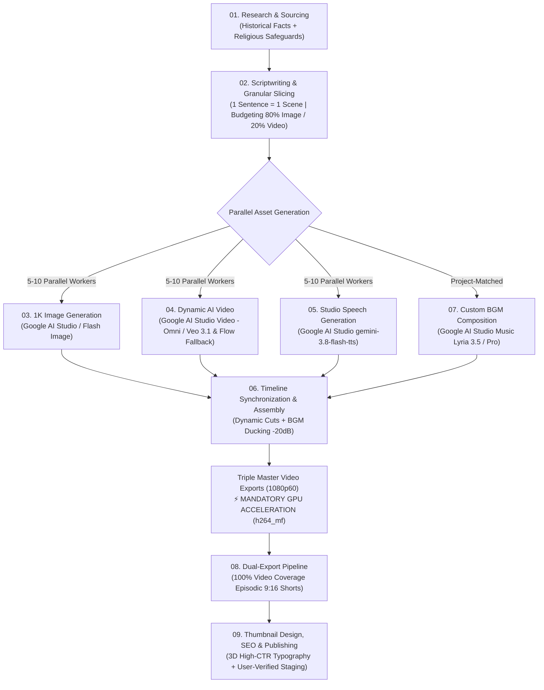

# 00. MASTER SYSTEM INSTRUCTION & NETWORK ORCHESTRATION MANUAL
**Ecosystem:** Simple History Teller Triple-Channel Automated Production Network  
**Channels (exact names — কখনো বদলাবে না):**
* 🇧🇩 **Simple History Teller Bangla** (Bengali Core Documentary Channel)
* 🌍 **Simple History Teller** (English Global Documentary Channel)
* 🇮🇳 **Simple History Teller Hindi** (Hindi/Hindustani High-Scale Channel)

---

## 1. Executive Mission & Network Philosophy

This document serves as the supreme operational blueprint for autonomous AI agents, orchestrators, and production workers responsible for generating full-length (12–20 minute), broadcast-grade historical animated explainer documentaries.

The network operates on three non-negotiable principles:
1. **Zero Dead Air & Rapid Pacing (Granular Cutting):** No single visual asset may remain static on screen for more than 5 to 12 seconds. A single thought/sentence equals one granular shot. An entire 15-minute documentary consists of 65 to 100+ granular cuts, creating an engaging, addictive YouTube retention curve similar to *OverSimplified* and *Simple History*.
2. **True Multi-Worker Parallel Concurrency:** Generating assets sequentially (one after another) is strictly prohibited. Every phase—whether generating 60+ images, 10+ AI video motion clips, or 60+ Google AI Studio speech blocks—must run across **5 to 10 parallel workers/agents** simultaneously to finish production in minutes rather than hours.
3. **Historical Rigor & Sacred Religious Reverence (Pro-Islamic Posture):** History is presented as archaeological, documentary, and chronicled records. We do not contest faith or claim religious scriptures are false. When historical matters touch religious narratives, theological origins, or sacred history, the narration must be respectful, objective, and maintain a dignified, favorable, and reverent posture towards Islam.

---

## 1A. ASSISTANT EXECUTION RULE — SINGLE AGENT, NO SUBAGENTS (MANDATORY)

> [!IMPORTANT]
> **The coding assistant working in this project MUST NEVER launch subagents (Task / parallel agents) for its own implementation work** — coding, editing, rendering, uploading, or browser automation. All work is done by the single main agent, sequentially, file by file. Subagents lose project context and produce errors.
> **Scope clarification (no contradiction with Principle 2):** the production pipeline multi-worker concurrency (AI Studio / Flow / TTS batch workers driven via daemon scripts, ffmpeg batches) REMAINS mandatory — those are pipeline generation workers executed as scripts/tools, NOT assistant subagents. The ban covers only the assistant delegating its own tasks to subagents.

---

## 2. End-to-End Production Pipeline Architecture

---

## 3. Strict Religious Sensitivity & Ethical Safeguards (Pro-Islamic Stance)

When discussing human origins, early civilizations, philosophy, scientific discoveries, or ancient rulers, tension can arise between secular archaeological theories and religious beliefs. The system mandates strict editorial policies:

### 3.1 The Documentary Neutrality & Disclaimer Rule
* Whenever discussing ancient anthropological theories (e.g., prehistoric evolution of speech, early cave societies, mythological origins), the script must explicitly clarify:
  > *"ঐতিহাসিক ও প্রত্নতাত্ত্বিক গবেষকরা প্রাচীন লিপি এবং জীবাশ্ম পরীক্ষা করে যা আবিষ্কার করেছেন, আমরা কেবল সেই প্রচলিত ঐতিহাসিক তথ্যগুলো তুলে ধরছি। এটি কোনো ধর্মীয় বিশ্বাসের বিকল্প বা বিরোধিতা নয়।"*  
  > *(English: "We are presenting what archaeological excavations and ancient historical records reveal; this documentary presents secular historical research, not a contradiction of religious faith.")*
* **Never mock religious narratives:** The script must never claim religious accounts are "fake", "fairy tales", or "primitive myths". Instead, use phrases like *"ধর্মীয় ও ঐশ্বরিক বিশ্বাস অনুসারে...", "ঐতিহাসিক রেকর্ডের পাশাপাশি..."*.

### 3.2 Favorable & Reverent Posture Towards Islam
* **Absolute Reverence for Prophets and Islamic Belief:** Prophets of Allah (Adam AS, Nuh AS, Ibrahim AS, Musa AS, Isa AS, Muhammad ﷺ) must **NEVER** be caricatured, satirized, or depicted in stickman/cartoon drawings. Any mention must use standard Islamic honorifics (আলাইহিস সালাম, সাল্লাল্লাহু আলাইহি ওয়া সাল্লাম) and be delivered with deep dignity.
* **Pro-Islamic Alignment on Origins:** When historical narratives touch topics addressed in Islamic theology (e.g., the first human speech taught to Prophet Adam AS, preservation of Arabic, ancient Babylon, King Nimrod, Pharaohs of Egypt):
  * Acknowledge that secular historians debate between evolutionary language theories, while Islamic belief clearly states that language and knowledge of names were taught to humankind from creation.
  * Always conclude discussions on human intellect and language with reverence: human communication is a miraculous, unparalleled faculty gifted to mankind.
  * Highlight the moral lessons taught in the Quran and Islamic historical scholarship (Ibn Khaldun, Al-Tabari, Al-Biruni) to show that Muslim scholars were pioneers of objective historical analysis.

---

## 4. Multi-Worker Concurrency Architecture (10x Acceleration)

> [!IMPORTANT]
> **STRICT COMPULSORY MANDATE: MINIMUM 5 PARALLEL WORKERS / TABS FOR ALL BATCH TASKS**
> Sequential single-worker loops (`for (const item of items) { await generate(item); }`) are strictly prohibited in production. Running a single worker to generate 60+ voice clips or images takes 15–20 minutes, whereas distributing the queue across **5 to 10 parallel workers** completes the entire workload in under 2 minutes.

### Concurrency Allocations:
| Pipeline Phase | Total Items (Typical) | Worker Concurrency | Time Required |
| :--- | :--- | :--- | :--- |
| **03. Image Generation** | 50–70 1K Widescreen Shots | **5 to 10 Parallel Workers** | ~2 to 4 minutes |
| **04. Video Clip Generation** | 10–15 Dynamic Motion Clips | **5 to 10 Parallel Workers** | ~3 to 5 minutes |
| **05. AI Studio Speech** | 60–90 Scene Voice Blocks | **5 Parallel Workers/Tabs** | ~1 to 2 minutes |
| **07. Custom Soundtrack** | Project-Specific Score | **1 Dedicated Composer Worker** | ~40 seconds |

Every script in `tools/` must implement Promise pools, worker queues, or concurrent tabs via Chrome CDP (`http://127.0.0.1:9224`) and the Automation Daemon (`http://127.0.0.1:9333`).

### 4.1A Mandatory Observability & Trusted-Click Contract

Every browser worker MUST follow [`10_AUTOMATION_OBSERVABILITY_AND_PORTABILITY.md`](10_AUTOMATION_OBSERVABILITY_AND_PORTABILITY.md). In particular, every job records its project, worker name, account slot and tab name; saves screenshot/state evidence every 5–10 seconds; and reports an explicit failure taxonomy. Before any settings, prompt, or `Run`/`Generate` action, the named Electron BrowserView MUST pass its geometry-health gate. `Run`/`Generate` actions MUST use a trusted CDP pointer or keyboard interaction and a verified state transition—DOM `element.click()` events, arbitrary `pages()[0]` fallbacks, and attempts to interact with a collapsed/hidden BrowserView are forbidden.

### 4.2 Mandatory Image Model Fallback Hierarchy & Thinking Level Mandate
> [!IMPORTANT]
> **THINKING LEVEL MUST ALWAYS BE SET TO HIGH (`Thinking: High`)!**
> Across all Google AI Studio operations—including Image Generation, Video Generation, Voice Synthesis, and Screenplay Processing—the Thinking Level MUST ALWAYS be set to **HIGH**. This guarantees deep reasoning, factual adherence, complex scene composition, and superior artifact quality.
>
> **IMAGE GENERATION MODEL PRIORITY & FAILOVER HIERARCHY:**
> 1. 🥇 **Primary:** `gemini-nano-banana-2.1` (**Nano Banana 2.1**) — Ultra-high visual fidelity, factuality, and consistency.
> 2. 🥈 **Tier 2 Fallback:** `gemini-3.1-flash-image` (**Nano Banana 2**) — Automatically engaged when Nano Banana 2.1 reaches daily account quota limits.
> 3. 🥉 **Tier 3 Fallback:** `gemini-3.1-flash-lite-image` (**Nano Banana 2 Lite**) — Engaged when Nano Banana 2 reaches account quota limits.
>
> **MANDATORY HOOK & OUTRO DYNAMIC VIDEO RULE:**
> * The **first scenes (Opening Hook)** and **last scenes (Closing Outro/CTA)** MUST ALWAYS be dynamic video clips (`DYNAMIC_AI_VIDEO`). Leaving the opening or closing scenes static is strictly forbidden for broadcast production.

### 4.3 Story-Driven Character Style Determination & The 4 Official Presets
> [!IMPORTANT]
> **STYLE IS NEVER MONOLITHIC — IT IS DETERMINED BY THE STORY!**
> Visual style and character design are NEVER hardcoded to a single look (such as only Sticky Meme). Instead, the style is selected during **Research & Scriptwriting** based on the specific historical story, era, and emotional gravity:
>
> 1. **Preset 1: STICKY-MEME (`PRESET_STICKY_MEME`):**
>    * *Tone:* Satirical, comedic, fast-paced, human irony, OverSimplified benchmark.
>    * *Visuals:* Smooth ovoid white head, 5px solid black contours, stick-figure limbs, flat saturated vector fills.
>    * *Anchor Reference:* [`references/ref_host_sticky_meme.jpg`](file:///d:/Developing%20Projects/Itihash%20Explainer%20Video/references/ref_host_sticky_meme.jpg)
> 2. **Preset 2: SIMPLE-HISTORY (`PRESET_SIMPLE_HISTORY`):**
>    * *Tone:* Classic military/civilization documentary, graphic novel clarity, educational balance.
>    * *Visuals:* Detailed 2D animation, realistic proportions with bold comic inks, cel-shaded lighting.
>    * *Anchor Reference:* [`references/ref_host_simple_history.jpg`](file:///d:/Developing%20Projects/Itihash%20Explainer%20Video/references/ref_host_simple_history.jpg)
> 3. **Preset 3: MYSTERY-NOIR (`PRESET_MYSTERY_NOIR`):**
>    * *Tone:* Unsolved historical conspiracies, ancient secrets, espionage, deep suspense.
>    * *Visuals:* High-contrast chiaroscuro, flickering warm torchlight, deep ominous shadows, gritty paper textures.
>    * *Anchor Reference:* [`references/ref_host_mystery_noir.jpg`](file:///d:/Developing%20Projects/Itihash%20Explainer%20Video/references/ref_host_mystery_noir.jpg)
> 4. **Preset 4: ISLAMIC-REVERENT (`PRESET_ISLAMIC_REVERENT`):**
>    * *Tone:* Sacred origins, Islamic Golden Age, theological milestones, philosophical epics.
>    * *Visuals:* Serene illuminated manuscript aesthetics, golden arabesque borders, dignified polymath scholars, soft divine light halos.
>    * *Anchor Reference:* [`references/ref_host_islamic_reverent.jpg`](file:///d:/Developing%20Projects/Itihash%20Explainer%20Video/references/ref_host_islamic_reverent.jpg)
>
> * **The Anchor/Host Mandate (Wise Elderly Male Scholar):**
>   * The Anchor/Time Chronicler is **ALWAYS MALE (পুরুষ)**.
>   * The Anchor is **ALWAYS AN ELDERLY PERSON (বয়স্ক ব্যক্তি)**: Bald crown, white hair on sides, full bushy white beard, wire-rim spectacles, earthy brown scholar robe/tunic, antique history journal with gold emblem, and flaming torch.
>   * When generating Host scenes, workers must ALWAYS attach that style's official reference image (`ref_host_*.jpg`) to maintain 100% brand continuity.

### 4.4 Anchor Voice Casting Mandate: Cruz with Style Prompt (Elderly Male Voice)
> [!CAUTION]
> **YOUNG / YOUTHFUL VOICES (LIKE PUCK) ARE STRICTLY BANNED FOR THE ANCHOR!**
> The Anchor is a wise, elderly historian with a white beard. Voicing him with a young, juvenile voice destroys character credibility.
> * **Anchor Voice (`TIME_CHRONICLER`):** In Google AI Studio Speech, the designated voice is **`Cruz`** with the mandatory **Style Prompt**:
>   * **Base Voice:** `Cruz` (or fallback `Charon` / `Fenrir`)
>   * **Style Prompt Field:** `An Old Story Teller, Old Man voice`
>   * **How it operates:** Clicking the `Style ▾` button right next to the Speaker selector and typing `An Old Story Teller, Old Man voice` modally shapes Cruz into a weathered, deliberate, wise elderly male storyteller.
> * Young voices like `Puck` may ONLY be used for minor youthful side characters (e.g. juvenile citizens, comic figures).

### 4.5 Mandatory AI Studio Video Generation (Zero Local Software Fake Clips)
> [!CAUTION]
> **CREATING LOCAL PAN/ZOOM "FAKE VIDEOS" DISGUISED AS AI VIDEO IS STRICTLY FORBIDDEN!**
> "ভিডিও মানেই এআই স্টুডিওতে জেনারেট করতে হবে।"
> All scenes designated as `DYNAMIC_AI_VIDEO` MUST be genuinely generated via **Google AI Studio Video (`gemini-omni-1.1-flash`, `veo-3.1-generate-preview`, `veo-3.1-fast-generate-preview`)** or **Google Flow**.
> Re-exporting static images with software Ken-Burns pan/zoom and naming them `.mp4` video clips is strictly forbidden. The system must prompt AI Studio Video using the scene's anchor image + action motion prompt and download the real 24fps motion MP4.

### 4.1 Multi-Account Rotation & Dynamic Rate-Limit Failover Pool

> [!IMPORTANT]
> **AUTOMATIC ACCOUNT SWITCHING ON QUOTA EXHAUSTION IS MANDATORY!**
> When generating high-volume assets (especially Google AI Studio Speech and Image batches), individual accounts may hit daily rate limits or display quota prompts (*"Upgrade to unlock more"* or *"user has exceeded quota"*).
> The pipeline MUST NOT halt or fail. Instead, it must dynamically switch to the next authenticated Pro account in the rotation pool:
>
> 1. **Multi-Account URL Routing:** Google AI Studio maps authenticated multi-login accounts directly via URL index paths:
>    * Account 0: `https://aistudio.google.com/u/0/`
>    * Account 1: `https://aistudio.google.com/u/1/` (`bmajnu980@gmail.com` - Pro)
>    * Account 2: `https://aistudio.google.com/u/2/` (`bmajnu9811@gmail.com` - Pro)
>    * Account 3: `https://aistudio.google.com/u/3/` (`badiuzzaman.majnu123@gmail.com` - Pro)
>    * Account 4: `https://aistudio.google.com/u/4/` (`msrosyafrin@gmail.com` - Pro)
>    * Account 5: `https://aistudio.google.com/u/5/` (`bmajnu981@gmail.com` - Pro)
>    * Account 6: `https://aistudio.google.com/u/6/` (`badiuzzaman.majnu1@gmail.com` - Pro)
> 2. **Automatic Detection & Failover Trigger:** If an active worker encounters an HTTP 429, a quota dialog, or generation block on index `/u/N/`, it automatically logs the event, marks index `N` as rate-limited in `config/aistudio_accounts.json`, and routes remaining tasks to `/u/N+1/`.
> 3. **Persistent Profile Reuse:** Chrome profile (`chrome_aistudio_profile_3`) maintains active authentication cookies across sessions, eliminating repetitive OTP or login challenges during normal runs.

---

## 5. Custom Story-Matched BGM Mandate (Zero Static Placeholder BGM)

> [!CAUTION]
> **REUSING A SINGLE STATIC BGM ACROSS MULTIPLE PROJECTS IS STRICTLY FORBIDDEN!**
> Reusing a generic looping track across different historical eras breaks immersion and ruins documentary quality.
> Every episode MUST have an era-authentic, story-matched custom background score (`audio/bgm.mp3`).
> **Primary Generation Engine:** **Google AI Studio Music (`https://aistudio.google.com/app/new_music?model=lyria-3.5` / Lyria 3.5 & Lyria 3 Pro Preview)**. Prompts must be timestamp-structured (`[mm:ss - mm:ss]` Intro, Build, Climax, Outro) matching the emotional arc of the historical documentary. Alternatively, use Gemini Music or vetted CC0/Public Domain archives matching the specific civilization.

---

## 6. Modular Documentation Map

Each phase has its own self-contained instruction document equipped with rules, prompts, do's/don'ts, and production-ready automation code:

1. **[01_RESEARCH_AND_HISTORICAL_SOURCING.md](file:///d:/Developing%20Projects/Itihash%20Explainer%20Video/instructions/01_RESEARCH_AND_HISTORICAL_SOURCING.md):** Fact extraction, source grading, archaeological vetting, and religious sensitivity frameworks.
2. **[02_SCRIPTWRITING_AND_SCENE_BREAKING.md](file:///d:/Developing%20Projects/Itihash%20Explainer%20Video/instructions/02_SCRIPTWRITING_AND_SCENE_BREAKING.md):** Image-friendly and video-friendly scriptwriting, granular 1-sentence scene slicing, and asset budgeting (80% static image / 20% AI motion video).
3. **[03_IMAGE_GENERATION_AUTOMATION.md](file:///d:/Developing%20Projects/Itihash%20Explainer%20Video/instructions/03_IMAGE_GENERATION_AUTOMATION.md):** 1K widescreen prompt formulation, negative prompt sanitization, mascot anchor chaining, and 5-10 worker parallel generation code.
4. **[04_VIDEO_GENERATION_AUTOMATION.md](file:///d:/Developing%20Projects/Itihash%20Explainer%20Video/instructions/04_VIDEO_GENERATION_AUTOMATION.md):** Identifying motion-critical scenes, Google Flow video prompting, credit approval handling, and 5-worker concurrent generation.
5. **[05_AUDIO_GENERATION_AI_STUDIO.md](file:///d:/Developing%20Projects/Itihash%20Explainer%20Video/instructions/05_AUDIO_GENERATION_AI_STUDIO.md):** Google AI Studio `gemini-3.8-flash-tts` persona casting, expression tags, quota/session management, and 5-worker parallel tab generation fleet.
6. **[06_TIMELINE_SYNC_AND_POST_PRODUCTION.md](file:///d:/Developing%20Projects/Itihash%20Explainer%20Video/instructions/06_TIMELINE_SYNC_AND_POST_PRODUCTION.md):** Audio-driven dynamic timeline alignment, Ken-Burns camera math, BGM sidechain ducking (-20 dB), and **MANDATORY GPU Hardware Acceleration** (`-c:v h264_mf` / NVIDIA D3D11 MFT) producing broadcast 1080p60 exports.
7. **[07_BGM_AND_SOUNDTRACK_CURATION.md](file:///d:/Developing%20Projects/Itihash%20Explainer%20Video/instructions/07_BGM_AND_SOUNDTRACK_CURATION.md):** Story-specific BGM composition via Google AI Studio Music (Lyria 3.5 / Lyria 3 Pro Preview), timestamped prompt architecture, and historical civilization genre matrix.
8. **[08_DUAL_EXPORT_SHORTS_REELS_PIPELINE.md](file:///d:/Developing%20Projects/Itihash%20Explainer%20Video/instructions/08_DUAL_EXPORT_SHORTS_REELS_PIPELINE.md):** GPU-accelerated dual-export engine slicing master long-form videos into episodic 9:16 vertical shorts with 100% video coverage (4–5 full episodes under 3 min or 8–11 viral clips).
9. **[09_THUMBNAIL_DESIGN_SEO_AND_PUBLISHING_SOP.md](file:///d:/Developing%20Projects/Itihash%20Explainer%20Video/instructions/09_THUMBNAIL_DESIGN_SEO_AND_PUBLISHING_SOP.md):** High-CTR 3D stylized thumbnail design, viral hook naming conventions, browser visibility protocols, and user-verified form staging before saving.

---

## 7. Universal Hardware Acceleration & Zero-Error Hierarchy (GPU / APU / CPU)

> [!IMPORTANT]
> **MULTI-TIER HARDWARE ADAPTATION (GPU $\to$ APU $\to$ CPU ZERO-ERROR GUARANTEE):**
> The system dynamically inspects the host computer's display controllers and configures the fastest possible rendering pipeline without ever throwing an error:
> 
> 1. **Tier 1: Dedicated GPU (NVIDIA GeForce / AMD Radeon Discrete):**  
>    Utilizes dedicated NVENC / VCN silicon via Windows Media Foundation (`-c:v h264_mf`) delivering **2.5x to 3.8x real-time speed** with minimal system power.
> 2. **Tier 2: APU / Integrated Graphics (AMD Ryzen APU / Intel UHD & Iris Xe):**  
>    On PCs and laptops without a dedicated graphics card, the engine automatically routes hardware encoding through the **APU's onboard GPU** via D3D11 MFT, `h264_amf`, or `h264_qsv`. No dedicated GPU is required, and renders run smoothly and quickly.
> 3. **Tier 3: Universal CPU Software Fallback (`libx264 veryfast`):**  
>    If running in a basic environment, virtual machine, or if hardware acceleration is unsupported/crashes, the engine **seamlessly auto-recovers to CPU software mode**.
> 4. **Runtime Zero-Error Recovery:** If any hardware glitch occurs mid-render on a scene segment, the worker catches the exception, switches to CPU mode for that segment, and completes the entire video without crashing or erroring.

All agents and subagents must reference the relevant module before executing any production task.
