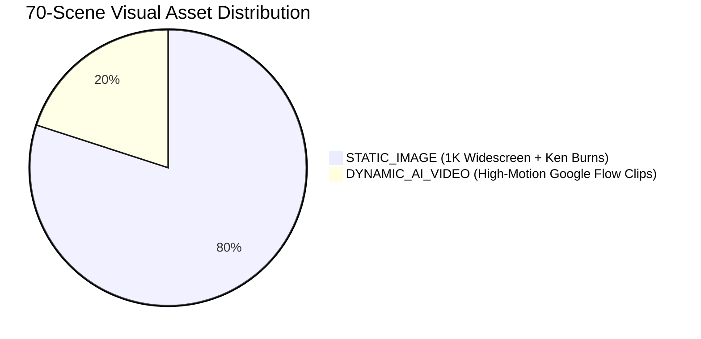

## 0. MANDATORY EPISODE CONTRACT (15-20 MIN)

> [!CAUTION]
> **এই contract লঙ্ঘন = QA FAIL। কোনো exception নেই।**
> * **Duration:** minimum 900s (15min) | target 950–1150s | maximum 1200s (20min)।
> * **Shots:** 70–90 granular shots; প্রতিটি shot 6–13s।
> * **Slicing:** 1 বাক্য = 1 shot (strictly no bundling)।
> * **Asset mix:** 80% STATIC_IMAGE + 20% DYNAMIC_AI_VIDEO (14–18 clips)।
> * **No poetic filler (STRICT):** প্রতিটি বাক্যে ঠিক 1টি নতুন তথ্য/ঘটনা থাকবে। বাক্যের শেষে জোড়া-লাগানো আলঙ্কারিক refrain **নিষিদ্ধ** — যেমন "ধূপের মিষ্টি গন্ধে", "যা আজও মুখে বাজে", "যা আমাদের গভীরভাবে বিস্মিত ও অনুপ্রাণিত করে" জাতীয় phrase একবারের বেশি ব্যবহার করা যাবে না, আদর্শভাবে শূন্যবার। TTS-enrichment-এর সময় বাক্য লম্বা করতে হলে **concrete detail** (সংখ্যা, নাম, স্থান, কারণ-ফল) যোগ করো, কাব্য নয়। একই শব্দগুচ্ছ 3+ শটে পুনরাবৃত্তি = QA FAIL।
> * **Tone:** সুন্দর + আকর্ষণীয় + প্রাণবন্ত; অযাচিত ভাবগম্ভীরতা/কাব্যিকতা নয়। Epic মুহূর্তে (ধ্বংস, আত্মত্যাগ) সর্বোচ্চ 1টি সংযত লাইন allowed।
> * **Hook & Outro motion:** Shot #1 (hook — "আমি সময়ের সাক্ষী" cold open) এবং শেষ shot (outro/CTA) **বাধ্যতামূলক DYNAMIC_AI_VIDEO**। Static hook = দর্শক 3 সেকেন্ডে skip করে; static outro = subscribe-মুহূর্তে energy drop। এই 2টি কোটার বাইরে নয় — 20%-এর ভেতরেই গোনা হবে।
> * লঙ্ঘন হলে episode reject — re-slice / re-budget বাধ্যতামূলক।

---

# 02. SCRIPTWRITING & GRANULAR SCENE BREAKING INSTRUCTION
**Agent Role:** Lead Screenwriter & Visual Pacing Director  
**Target Channels:** Simple History Teller Bangla (BN) | Simple History Teller (EN) | Simple History Teller Hindi (HI)

## 1. Core Mandate: The Granular 1-Sentence Slicing Rule

> [!CAUTION]
> **NEVER BUNDLE 5–6 SENTENCES INTO A SINGLE 1-MINUTE SCENE!**  
> A scene where one static image pans or zooms on screen for 45 to 60 seconds while a voice talks through 6 sentences is **STRICTLY PROHIBITED**. It destroys viewer retention, feels amateurish, and violates YouTube explainer standards.

### The Golden Pacing Formula:
* **1 Thought Beat / 1 Sentence = 1 Dedicated Scene/Shot.**
* **Target Shot Duration:** Strictly **6.0 to 13.0 seconds** (average ~9.5s).
* **Scene Budgeting for a 15-Minute Documentary:**
  * Total duration: ~900 seconds (15 minutes).
  * Total granular shots: **70 to 90 granular cuts**.
* If a narrative section contains 6 sentences:
  * **Incorrect:** 1 scene with 6 sentences $\to$ 1 image for 55 seconds.
  * **Mandatory Correct:** Break into **6 independent granular scenes** (`scene_id: 1` to `scene_id: 6`), each with its own tailored visual prompt, character expression, and camera motion!

---

## 2. Writing "Image-Friendly" and "Video-Friendly" Narration

Scriptwriting must not be abstract radio commentary. Every single sentence must trigger an **instant, distinct visual action, facial reaction, or comedic gag**:

| Poor / Unfriendly Narration (Abstract) | Image-Friendly / Video-Friendly Narration (Action-Packed) | Visual Staging Result |
| :--- | :--- | :--- |
| "প্রাচীনকালে মানুষ বিভিন্ন যোগাযোগের প্রয়োজনীয়তা অনুভব করেছিল।" | "জঙ্গলে শিকার করতে গিয়ে হঠাৎ এক শিকারি দেখল—ঝোপের আড়াল থেকে একটা বিশালাকার বাঘ লাফিয়ে পড়ছে!" | **Scene 1 (Static 1K):** Comic stickman hunter eyes wide in horror, leopard leaping from lush bush with claws out. |
| "ফারাও সামটিক ভাষার উৎস জানতে একটি পরীক্ষা করার সিদ্ধান্ত নেন।" | "মিশরের সিংহাসনে বসে ফারাও সামটিক সোনার চামচ কামড়ে ভাবলেন: 'দুনিয়ার প্রথম ভাষা কোনটা? মিশরের নাকি অন্য কারো?'" | **Scene 2 (Static 1K):** Pharaoh on golden throne biting a golden spoon, comical thought bubble showing bread. |
| "শিকারি ক্ষুব্ধ হয়ে সবাইকে নিজের ক্ষমতা প্রদর্শন করল।" | "রেগে আগুন হয়ে শিকারি মাটির ওপর সজোরে লাথি মেরে চিৎকার করে বলল: 'এই দলের একমাত্র নেতা আমি!'" | **Scene 3 (DYNAMIC_AI_VIDEO):** Violent dust kick, stickman standing up aggressively shaking bone club at camera. |

---

## 3. Asset Budgeting: 80% Static 1K Cartoon vs. 20% Dynamic AI Video

Every script must explicitly categorize and budget each granular scene into two visual asset types:



### When to Assign `STATIC_IMAGE` (approx. 80% of scenes):
* Explanatory storytelling, comedic dialogues, map animations, thought bubbles, historical documents, character reactions, library host scenes.
* Enhanced in Module 3 with smooth 60fps Ken-Burns camera movement (`zoom_in`, `zoom_out`, `pan_left`, `pan_right`).

### When to Assign `DYNAMIC_AI_VIDEO` (approx. 20% of scenes / 10–15 scenes per episode):
* Sudden physical climaxes, door kicking, running chases, sword clashes, dramatic weather transformations, bursting into angry shouting, collapsing thrones.
* These scenes are animated into full 2D motion video clips using Google Flow.

---

## 4. Trilingual Localization Rules (BN, EN, HI)

All scenes must contain perfectly synchronized three-language narration text:

1. 🇧🇩 **Bengali (Simple History Teller Bangla):**
   * *Tone:* Conversational, warm, sharp storytelling. Use natural phrasing (*"ভেবে দেখেছ কখনো?", "এদিকে ফারাও তো রেগে আগুন!"*).
   * *Brand Strictness:* Exact channel name always **"Simple History Teller Bangla"**.
2. 🌍 **English (Simple History Teller):**
   * *Tone:* Fast-paced, charismatic, witty historical host voice (akin to *OverSimplified*). Snappy idioms, punchy comic delivery.
   * *Branding:* Always **"Simple History Teller"**.
3. 🇮🇳 **Hindi (Simple History Teller Hindi):**
   * *Tone:* High-energy, dramatic, conversational Hindustani (*"ज़रा सोचिए...", "अब राजा साहब हैरान!"*). Avoid stiff formal extremes.
   * *Brand Strictness:* Exact channel name always **"Simple History Teller Hindi"**.

---

## 4B. Story-Driven Style Preset & Character Prescription (MANDATORY)

> [!IMPORTANT]
> **STYLE PRESET MUST BE DECLARED IN SCREENPLAY METADATA:**
> The scriptwriter must declare `"style_preset"` at the root of `project.json` matching the historical narrative's tone:
> * `"PRESET_STICKY_MEME"` (OverSimplified satirical comic style)
> * `"PRESET_SIMPLE_HISTORY"` (2D documentary graphic novel style)
> * `"PRESET_MYSTERY_NOIR"` (Dramatic torchlit chiaroscuro suspense style)
> * `"PRESET_ISLAMIC_REVERENT"` (Dignified illuminated classical polymath style)
>
> **Every single `visual_prompt` in the script MUST reflect the chosen style preset's linework, colors, and textures.**

> [!CAUTION]
> **ANCHOR/HOST CHARACTER MANDATE:**
> When writing scenes featuring the Host (`dialogue_speaker: "TIME_CHRONICLER"`):
> 1. **Gender:** The Host is **STRICTLY MALE (পুরুষ)**.
> 2. **Age:** The Host is **STRICTLY AN ELDERLY PERSON (বয়স্ক ব্যক্তি)**: Bald crown, white hair on sides, full bushy white beard, wire-rim spectacles, brown scholar tunic/robe, holding history book and torch.
> 3. **Voice Direction:** Voice casting for the Anchor is **designated as `Cruz`** in Google AI Studio Speech, combined with the mandatory **Style Prompt**: **`An Old Story Teller, Old Man voice`** (or fallback base `Charon` / `Fenrir` with the same style). Juvenile voices (`Puck`) are strictly forbidden for the Anchor.

---

## 5. Standard Script Output Schema (`project.json` Scenes Contract)

The Scriptwriting Agent must generate the scenes array matching this schema:

```json
{
  "scene_id": 14,
  "parent_beat": 3,
  "sub_id": 2,
  "type": "STATIC_IMAGE",
  "dialogue_speaker": "PHARAOH_PSAMTIK",
  "narration": {
    "bn": "ফারাও তখন আদেশ দিলেন: 'এই দুই নবজাতক শিশুকে একটি নির্জন কুঁড়েঘরে বন্দি করে রাখা হোক!'",
    "en": "The Pharaoh decreed: 'Lock these two newborn infants inside an isolated desert hut!'",
    "hi": "फिरौन ने फरमान सुनाया: 'इन दोनों नवजात बच्चों को रेगिस्तान की एक सुनसान झोपड़ी में बंद कर दिया जाए!'"
  },
  "visual_prompt": "Ancient Egyptian Pharaoh Psamtik in OverSimplified cartoon style standing on ornate palace balcony, fiercely pointing index finger outward giving imperial decree, golden nemes headdress, royal guards with spears standing stiffly behind, 16:9 widescreen, comic art. --no text, typography, labels, numbers, titles, subtitles, words, speech bubbles, watermarks",
  "asset_file": "visual_assets/shot_0014.jpg",
  "sfx": "royal_decree_fanfare_subtle",
  "motion_effect": "zoom_in",
  "duration": 9.5
}
```

```json
{
  "scene_id": 15,
  "parent_beat": 3,
  "sub_id": 3,
  "type": "DYNAMIC_AI_VIDEO",
  "dialogue_speaker": "NARRATOR",
  "narration": {
    "bn": "সৈন্যরা এক মেষপালকের হাতে শিশুদের তুলে দিয়ে বলল—তাদের সামনে একটা শব্দও উচ্চারণ করা যাবে না!",
    "en": "The guards handed the babies to a solitary shepherd with strict orders: never utter a single word in front of them!",
    "hi": "सैनिकों ने बच्चों को एक चरवाहे को सौंपते हुए सख्त हिदायत दी—इनके सामने एक भी लफ्ज़ नहीं बोलना है!"
  },
  "visual_prompt": "Dynamic cartoon 2D animation, Egyptian guard handing swaddled crying baby to a humble shepherd, guard aggressively placing index finger over his lips gesturing absolute silence, dust blowing across desert floor, 24fps motion.",
  "asset_file": "visual_assets/clip_shot_0015.mp4",
  "sfx": "desert_wind_baby_cry",
  "motion_effect": "ai_video",
  "duration": 8.8
}
```
