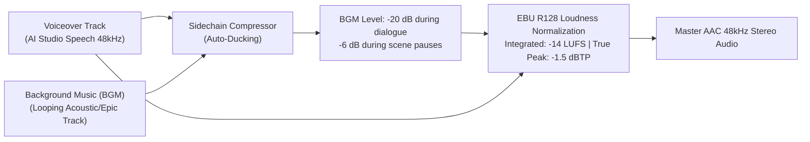

# 06. TIMELINE SYNCHRONIZATION & POST-PRODUCTION INSTRUCTION
**Engine:** Production Studio (`server.js`) & Native High-Performance FFmpeg/FFprobe Fleet  
**Output Standards:** Broadcast-Grade 1080p @ 60fps Triple Master Video Files  
**Target Channels:** Simple History Teller Bangla (BN) | Simple History Teller (EN) | Simple History Teller Hindi (HI)

## 1. The Dynamic Timeline Formula (Language-Adaptive "Zero Dead Air" Rule)

Because spoken speech lengths naturally differ across languages (e.g., Bengali phrasing takes ~15% longer than concise English, while Hindi rhythm has distinct syllable cadence), **a single rigid visual cut timeline across all languages causes awkward silence or cut-off speech**.

### Production Studio Dynamic Timing Formula:
1. For each scene $s$ and each language $L \in \{\text{bn}, \text{en}, \text{hi}\}$:
   * Measure raw voice duration: $d_{L,s} = \text{probeDuration}(\text{audio}_{L,s})$.
   * Compute calibrated scene duration with natural breathing room ($\Delta = 0.4\text{s}$):
     $$S_{L,s} = \max(\text{round}(d_{L,s} + 0.4, 2), 4.5\text{s})$$
2. Total language-specific timeline:
   $$T_L = \sum_{s=1}^{N} S_{L,s}$$
3. When rendering:
   * **Bengali Edition (`video_bn.mp4`):** Visual cuts switch precisely when the Bengali sentence completes.
   * **English Edition (`video_en.mp4`):** Visual cuts switch precisely when the English sentence completes.
   * **Hindi Edition (`video_hi.mp4`):** Visual cuts switch precisely when the Hindi sentence completes.

---

## 2. Ken-Burns 60fps Camera Mathematics (Jitter-Free)

Static cartoon images become mesmerizing when paired with subtle cinematic camera movement. To prevent the notorious pixel jitter common in naive FFmpeg `zoompan`, our engine executes **2X supersampling before zooming**:

```bash
scale=3840:2160:force_original_aspect_ratio=increase,crop=3840:2160,
zoompan=z='1+0.12*on/TOTAL_FRAMES':x='iw/2-(iw/zoom/2)':y='ih/2-(ih/zoom/2)':d=TOTAL_FRAMES:s=1920x1080:fps=60,
setsar=1,format=yuv420p
```

### Camera Motion Preset Library:
* `zoom_in`: Camera slowly pushes into character's eyes/expression (dramatic revelations).
* `zoom_out`: Camera pulls back from a focal detail to reveal the full chaotic scene (satirical punchlines).
* `pan_left`: Camera glides smoothly across the horizon/landscape (armies, migration).
* `pan_right`: Camera tracks forward progress (marching soldiers, traveling chronicler).
* `ai_video`: Native 24fps motion video clips from Google Flow, frame-cloned or trimmed to match exact scene duration.
* `ai_video` Slow-Match Rule (MANDATORY): ক্লিপের duration যদি scene audio (`S_{L,s}`) থেকে ছোট হয়, **ভিডিও ফ্রিজ/কাট করবে না** — `setpts` দিয়ে playback auto-slow করো যাতে ভিডিও ঠিক অডিও-দৈর্ঘ্যে ভরে: `setpts=(A/D)*PTS` যেখানে A=audio duration, D=clip duration; factor 0.5–1.0-এর মধ্যে রাখো (এর নিচে নামলে 2x loop + crossfade)। Factor, source/target duration রেন্ডার-লগে লিখতে হবে। Mismatch-এ ফ্রিজ-ফ্রেম = QA FAIL।

---

## 3. Broadcast Audio Mixing & Sidechain Ducking Architecture

Every episode combines three audio layers mastered to strict YouTube compliance standards:



### Exact FFmpeg Ducking & Loudnorm Filter:
```bash
-filter_complex \
"[0:a]aresample=48000,aformat=channel_layouts=stereo[vox]; \
 [1:a]aloop=loop=-1:size=2e+09,volume=0.15[bgm]; \
 [bgm][vox]sidechaincompress=threshold=0.02:ratio=8:attack=15:release=350[ducked_bgm]; \
 [ducked_bgm][vox]amix=inputs=2:duration=first:dropout_transition=0,loudnorm=I=-14:TP=-1.5:LRA=11[out]"
```

---

## 4. Hardware-Accelerated Rendering (GPU / APU / CPU Zero-Error Pipeline)

> [!IMPORTANT]
> **DYNAMIC HARDWARE ENCODING & ZERO-ERROR FAILOVER:**
> The render engine automatically determines hardware capabilities and adapts to any machine:
> * **Dedicated GPU:** Uses NVIDIA NVENC / AMD VCN via `-c:v h264_mf` (D3D11 MFT) for 2.5x–3.8x speed.
> * **APU / Integrated Graphics:** On systems without a dedicated GPU (e.g. AMD Ryzen APUs with Radeon Vega graphics or Intel Core CPUs with UHD/Iris Xe graphics), the engine routes hardware encoding through the **APU's onboard GPU** without error.
> * **CPU Software Auto-Fallback:** If no hardware encoder is present or if a hardware encode fails mid-process, the engine seamlessly recovers using `libx264 veryfast`, ensuring a **100% render success rate with zero errors**.
> 
> ### Why Task Manager Shows 5–15% Utilization (Dedicated Video Silicon):
> * Modern GPUs and APUs execute video encoding on a dedicated hardware chip (NVENC / VCN / QuickSync) separate from the 3D graphics cores.
> * Low 3D utilization is normal and keeps the system cool and quiet while encoding at over 2.5x real-time speed.

### Automated Render Trigger Script (`trigger_render_002.js`):
```javascript
const http = require('http');

const payload = JSON.stringify({
  langs: ['bn', 'en', 'hi'],
  bgmDb: -20,
  duck: true,
  useBgm: true,
  exportShorts: true // Auto-triggers 9:16 vertical shorts slicing upon master completion
});

const req = http.request('http://127.0.0.1:4000/api/project/<project_id>/render', {
  method: 'POST',
  headers: {
    'Content-Type': 'application/json',
    'Content-Length': Buffer.byteLength(payload)
  }
}, (res) => {
  let data = '';
  res.on('data', chunk => data += chunk);
  res.on('end', () => console.log('Render job initiated:', data));
});

req.write(payload);
req.end();
```

---

## 5. Output Verification & Quality Checklist

Before presenting the final master to the user or publishing:
* [ ] **GPU Hardware Acceleration:** Master export uses `h264_mf` (GPU) running at $\ge 2.0\times$ real-time speed.
* [ ] **Resolution & Framerate:** 1920×1080 @ 60fps across all 3 language exports (`video_bn.mp4`, `video_en.mp4`, `video_hi.mp4`).
* [ ] **Audio Loudness:** Evaluated via FFprobe `ebur128` confirming `-14 LUFS (±0.5)`.
* [ ] **Zero Dead Silence:** Confirm audio lane fills 100% of the video duration.
* [ ] **Dual-Export Shorts:** Sliced episodic vertical shorts (`renders/shorts/short_${lang}_part*.mp4`) generated with `metadata_distribution.json`.
* [ ] **File Sizes:** Each 15-minute 1080p60 episode should be between 200 MB and 300 MB.
* [ ] **Thumbnails & Metadata:** Verify `metadata/bn_thumbnail.jpg`, `metadata/en_thumbnail.jpg`, `metadata/hi_thumbnail.jpg`, and `metadata/youtube_seo.json` are generated.
* [ ] **Mandatory Contract Gate:** `total_duration_seconds >= 900` — লঙ্ঘন হলে QA FAIL।
* [ ] **Mandatory Contract Gate:** scene count >= 70 — লঙ্ঘন হলে QA FAIL।
* [ ] **Mandatory Contract Gate:** DYNAMIC_AI_VIDEO ratio 15–25% — লঙ্ঘন হলে QA FAIL।

---

## STUDIO PRO v2 UPGRADE SPECIFICATIONS (SHORTS BUILDER, BRANDED 9:16 OVERLAYS, CLEAN BADGES & AUTO-THUMBNAIL EMBED)

1. **Interactive Shorts Studio Mode & Custom Part Builder (`shorts_config`):**
   - Users and Agents can define any number of Shorts episodes (e.g., `5`, `8`, `10`, `12` parts) and exact scene boundaries (`From Scene #` → `To Scene #`) via the **Shorts Builder Dialog** (`POST /api/project/:id/shorts/suggest` & `POST /api/project/:id/shorts/save`).
   - In **9:16 Shorts Studio Mode**, the preview player switches to a Portrait 9:16 canvas dockable to the Left, Center, or Right, displaying live **Top & Bottom Branded Overlays**:
     - **Top Header Card:** Circular Channel Logo + Channel Name + Handle + Part Pill (`পর্ব ১ / ১০`) + Highlighted Short Viral Hook Title.
     - **Bottom Footer Card:** Main Video Title (`🎬 মূল ভিডিও: ...`) + Red Subscribe CTA Bar (`▶ সম্পূর্ণ ভিডিও দেখুন চ্যানেলে • SUBSCRIBE`).
   - All exported Shorts (`exports/shorts/short_${lang}_part${num}.mp4`) composite these exact branded overlay plates so top and bottom blurred zones are 100% professional and advertisement-ready.

2. **Clean On-Screen Character & Role Badges (Zero Gemini Voice Names):**
   - On-screen speaker badges (`#pvSpeakerBadge` and rendered segment overlays) must ONLY display the Character Icon, Character Name, and Character Role (e.g., `📜 মূল ধারাভাষ্যকার | ডকুমেন্টারি ভয়েস`).
   - Gemini AI Studio internal voice names (`Charon`, `Cruz`, `Fenrir`, `Puck`, `Orus`, `🔊 Charon`, etc.) are strictly stripped by `stripVoiceNameFromRole()` and must NEVER appear on video frames.

3. **Project-Based `thumbnails/` Folder & 0.8s Intro Thumbnail Embedding:**
   - Every project stores generated thumbnails inside its own `projects/<id>/thumbnails/` directory:
     - Master Thumbnails: `projects/<id>/thumbnails/master/master_thumbnail_{bn|en|hi}.png`
     - Shorts Thumbnails: `projects/<id>/thumbnails/shorts/short_part_{01..N}_{bn|en|hi}.png`
   - During rendering (`server.js` and `tools/dual_render_exporter.js`), the corresponding Master or Short thumbnail is automatically prepended for the first `0.8s` of the video stream (`embedIntroThumbnail: true`) so YouTube, Facebook, TikTok, and Instagram Reels auto-select the thumbnail without separate manual upload steps.

4. **Motion Text Cards, TV News Ticker, Channel Logo & Vox/Voice of Dhaka Cutout Pan:**
   - **64 Camera Motions & Transitions:** Includes `vox_cutout_pan_lr`, `vox_cutout_pan_rl`, `vod_spotlight_glide`, and `floating_card_pan` (floating foreground cutout gliding over a blurred/textured paper backdrop).
   - **Motion Text Cards:** Per-scene kinetic text cards (`voice_of_dhaka_quote`, `vox_yellow_highlighter`, `vox_crimson_stamp`, `breaking_news_lower_third`, `historical_date_plate`, `thinker_minimal_stat`) paired with real `.wav` SFX triggers (`public/assets/sfx/`).
   - **TV Channel Scrolling News Ticker:** Configurable Top or Bottom news crawl (`project.ticker_config`).
   - **Existing Projects Guardrail:** Never modify or overwrite existing project folders in `projects/` unless explicitly edited and saved by the user.
