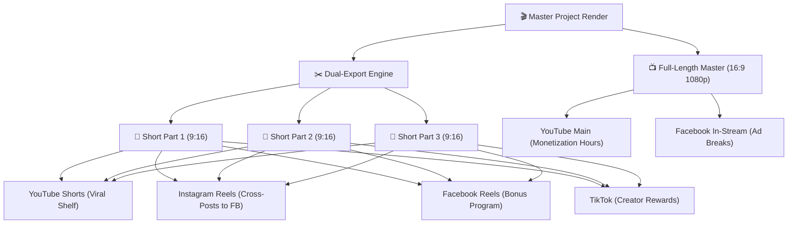

# 08. DUAL-EXPORT SHORTS, REELS & TIKTOK MULTI-PLATFORM PIPELINE
**Ecosystem:** Simple History Teller Triple-Channel Automated Production Network  
**Objective:** Simultaneously produce and export both broadcast Full-Length 16:9 Documentaries and Sliced 9:16 Vertical Episodic Shorts/Reels/TikTok Clips in a unified, synchronized render pipeline.

---

## 1. Executive Philosophy & Distribution Matrix

Audience consumption behavior is bifurcated across two distinct format paradigms:
1. **Deep Retention & High Ad RPM (Long-Form 16:9):**  
   Long-form storytelling (10–20 minutes) on **YouTube** and **Facebook In-Stream Video** generates high watch time, strong algorithmic authority, and premium CPM ad revenue.
2. **Viral Discovery & Top-of-Funnel Conversion (Vertical 9:16):**  
   Short-form clips (60–90 seconds) on **TikTok**, **Instagram Reels**, **YouTube Shorts**, and **Facebook Reels** have massive organic reach and algorithmic viral surges.

### The Episodic "100% Video Coverage" Strategy
> [!IMPORTANT]
> **ZERO TRUNCATION MANDATE (NO ABANDONED SCENES):**  
> A 12–20 minute documentary must never have 60% of its content arbitrarily discarded by hardcoding `if (parts.length >= 4) break;`.  
> Slicing must cover the entire documentary from Scene 1 to the final Outro Scene using one of two approved architectures:
>
> 1. **Architecture A (4 to 5 Complete Episodic Shorts — 2.5 to 3 Minutes Each):**  
>    * YouTube Shorts officially supports up to 3 minutes (180s).  
>    * A 12–15 minute documentary is divided into **4 to 5 full episodic chapters** (~150s to 175s each), covering the entire story from beginning to end.
> 2. **Architecture B (8 to 11 Bite-Sized Viral Shorts — 60 to 80 Seconds Each):**  
>    * Designed for TikTok and Instagram Reels.  
>    * The full timeline is sliced into **8 to 11 consecutive chronological episodes**, leaving zero scenes unrendered.

### High-CTR Viral Hook Naming Conventions
* Use culturally resonant, curiosity-inducing hooks rather than dry academic labels.  
  * *Example:* Instead of "প্রথম কর", use **"পৃথিবীর প্রথম চাঁদাবাজি ও ইতিহাসের প্রথম ডন"** ⚔️.
* **Thumbnail Rule:** Never write master timeline slices (like `০:০০ - ১:১২`) as the duration on a Short's thumbnail. The thumbnail must state either the Short's **actual duration** (e.g., `সময়: ১ মিনিট ১৩ সেকেন্ড`) or a clean episode badge (`১ম পর্ব`).
* See full details in [09_THUMBNAIL_DESIGN_SEO_AND_PUBLISHING_SOP.md](file:///d:/Developing%20Projects/Itihash%20Explainer%20Video/instructions/09_THUMBNAIL_DESIGN_SEO_AND_PUBLISHING_SOP.md).

Every short contains:
* **Top Header Badge:** Stylized Part Badge (`★ PART 1 ★` / `★ পর্ব ১ ★` / `★ भाग १ ★`) + Episode Title.
* **Centered Canvas:** 100% full-resolution, uncapped 16:9 animation centered in frame.
* **Blurred Ambient Backdrop:** Real-time blurred, color-matched motion canvas filling 1080x1920 vertical canvas.
* **Bottom Call-To-Action (CTA):** Sticky hook badge:
  `👉 সম্পূর্ণ ভিডিও দেখুন YouTube-এ: @SimpleHistoryTellerBangla`  
  `👉 Watch Full Story on YouTube: @SimpleHistoryTellerOfficial`  
  `👉 पूरी कहानी देखिए YouTube पर: @SimpleHistoryTellerHindi`

---

## 2. Technical Specifications

| Format Profile | Full Master Video (Long-Form) | Episodic Short (Vertical Clips) |
| :--- | :--- | :--- |
| **Aspect Ratio** | `16:9` Landscape | `9:16` Vertical |
| **Resolution** | `1920x1080` | `1080x1920` |
| **Frame Rate** | 60 fps (or 30 fps) | 60 fps |
| **Duration** | Full Runtime (10–20 mins) | 60s – 90s per part |
| **Audio Loudness** | -14 LUFS (EBU R128 / YouTube) | -14 LUFS (Normalized with audio fadeout) |
| **Primary Platforms** | YouTube Standard, Facebook Videos | TikTok, Instagram Reels, YouTube Shorts, FB Reels |
| **Export Directory** | `projects/<id>/renders/` | `projects/<id>/renders/shorts/` |
| **File Naming** | `video_${lang}.mp4` | `short_${lang}_part${num}.mp4` |

---

## 3. GPU Hardware-Accelerated Vertical Composition Pipeline

> [!IMPORTANT]
> **MANDATORY GPU HARDWARE ENCODING (`h264_mf`):**  
> Slicing Full HD 1080×1920 video at 60fps with real-time blur requires substantial processing power. Running this via software CPU causes high rendering times and frame drops.  
> The pipeline uses **16× downscaled background blur** (`scale=270:480,boxblur=4:2,scale=1080:1920`) combined with **NVIDIA GPU Media Foundation Hardware Encoding (`-c:v h264_mf -b:v 4500k`)**, delivering **>2.5x real-time export speeds**!

```bash
ffmpeg -hide_banner -y -reinit_filter 0 \
  -ss {START_SECONDS} \
  -i "{INPUT_VIDEO}" \
  -filter_complex "\
    [0:v]split=2[v_bg_in][v_fg_in];\
    [v_bg_in]scale=270:480:force_original_aspect_ratio=increase,crop=270:480,boxblur=4:2,scale=1080:1920,format=yuv420p[v_bg];\
    [v_fg_in]scale=1080:608:force_original_aspect_ratio=decrease,format=yuv420p[v_fg];\
    [v_bg][v_fg]overlay=0:656[v_comp];\
    [v_comp]drawbox=x=0:y=180:w=1080:h=180:color=black@0.65:t=fill,\
    drawbox=x=0:y=1560:w=1080:h=180:color=black@0.65:t=fill,\
    drawtext=text='★ {PART_LABEL} ★':fontcolor=gold:fontsize=52:x=(w-text_w)/2:y=200,\
    drawtext=text='{EPISODE_TITLE}':fontcolor=white:fontsize=36:x=(w-text_w)/2:y=270,\
    drawtext=text='👉 {CTA_TEXT}':fontcolor=white:fontsize=34:x=(w-text_w)/2:y=1620[v_out];\
    [0:a]afade=t=out:st={DUR-2}:d=2[a_out]\
  " \
  -map "[v_out]" -map "[a_out]" \
  -t {DURATION} \
  -c:v h264_mf -b:v 4500k -pix_fmt yuv420p -r 60 \
  -c:a aac -b:a 192k -movflags +faststart \
  "{OUTPUT_SHORT_PATH}"
```

---

## 4. Multi-Platform Publishing Matrix



---

## 5. Automated Metadata & Hashtag Generation

For each generated part, the system automatically writes `renders/shorts/metadata.json` containing:

1. **Title:** Hook + Part Badge (e.g. `The Secret of the First Human Language [Part 1] 🏛️`)
2. **Hashtags:**
   - English: `#history #animation #ancienthistory #mystery #part1 #shorts #reels #tiktok`
   - Bangla: `#ইতিহাস #অ্যানিমেশন #রহস্য #পার্ট১ #banglahistory #shorts #reels #tiktok`
   - Hindi: `#इतिहास #एनिमेशन #रोचक_तथ्य #भाग१ #hindihistory #shorts #reels #tiktok`
3. **Pinned Comment / Description:**  
   `"🔥 Watch the complete 15-minute documentary with full animation on our YouTube channel: @SimpleHistoryTeller (Link in Bio!)"`
