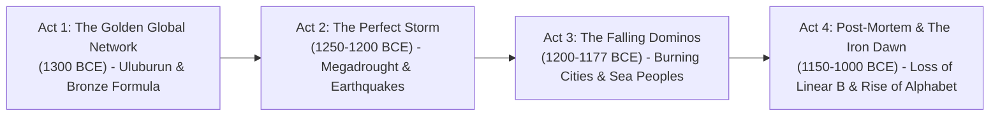

# R7 — SYNTHESIS (Research to Story Transformation)

Following the NYFA and Desktop Documentaries sequence outline standard, this document synthesizes findings from R1–R6 into a dramatic, high-retention documentary structure.

---

## 1. Core Documentary Premise (One-Sentence Message)
> **"৩০০০ বছর আগে পৃথিবীর সবচেয়ে সমৃদ্ধ ও পরস্পর নির্ভরশীল পরাশক্তিগুলো কোনো একটি একক শত্রুর কারণে নয়, বরং তীব্র খরা, ভূমিকম্প, বাণিজ্যের সংকট এবং জলদস্যুদের এক সম্মিলিত 'সিস্টেমস কলাপ্স'-এ তাসের ঘরের মতো ভেঙে পড়েছিল।"**  
> *(English: "Three thousand years ago, the most interconnected and advanced superpowers of the Bronze Age collapsed not from a single conqueror, but through a cascading 'systems collapse' of catastrophic megadrought, tectonic earthquake storms, severed tin supply chains, and desperate migrant raids.")*

---

## 2. Four-Act Dramatic Narrative Architecture

### **Act 1: The Golden Age of Bronze & The Fragile Network (c. 1350–1250 BCE)**
* **Beat 1 (Cold Open / The Mystery):** Around 1200 BCE, thriving civilizations across the Mediterranean—the Mycenaeans, Hittites, and city of Ugarit—were wiped off the map within a single human lifetime. How could an entire civilized world vanish? `[CLM-06, CLM-13]`
* **Beat 2 (The Ancient Globalized World):** Kings wrote to each other in cuneiform as "my brother," exchanging gold, lapis lazuli, and royal brides. `[CLM-01, CLM-06]`
* **Beat 3 (The Bronze Addiction):** Without bronze, armies had no swords or armor, and farmers had no plows. The recipe: 90% copper + 10% tin. `[CLM-02]`
* **Beat 4 (The Achilles' Heel):** Copper was nearby in Cyprus, but tin had to travel across thousands of kilometers of bandit-filled mountains from Central Asia. `[CLM-03]`
* **Beat 5 (The Proof in the Deep):** The Uluburun shipwreck: 10 tons of copper and 1 ton of tin—an entire army's arms package frozen in the sea. `[CLM-04, CLM-05]`

### **Act 2: The Perfect Storm — Nature Strikes (c. 1250–1200 BCE)**
* **Beat 6 (The Sky Goes Dark):** Modern paleoclimate pollen cores prove that around 1200 BCE, a 300-year megadrought struck. Crops withered from Greece to Syria. `[CLM-08, CLM-09]`
* **Beat 7 (A Matter of Life and Death):** The desperate Hittite royal letters begging Ugarit and Egypt for grain convoys. `[CLM-10]`
* **Beat 8 (Poseidon's Wrath):** Geologists uncover an "earthquake storm"—a 50-year sequence of violent tectonic ruptures collapsing the massive stone walls of Mycenae and Tiryns. `[CLM-12]`

### **Act 3: The Falling Dominos & The Sea Peoples (c. 1200–1177 BCE)**
* **Beat 9 (Panic on the Coast):** Tablet RS 20.238 at Ugarit: King Ammurapi's chilling letter: *"The enemy ships are here... my cities are burned."* The legend of the kiln and the archaeological truth. `[CLM-14, CLM-15]`
* **Beat 10 (The Burning of Hattusa):** The grand Hittite capital falls in flames; the royal family abandons their stone citadel. `[CLM-16]`
* **Beat 11 (Greek Amnesia):** Mycenaean palaces burn to ash. The scribes die, and the Linear B script is completely wiped out—Greece plunges into 400 years of illiteracy. `[CLM-17, CLM-18]`
* **Beat 12 (Who Were the Sea Peoples?):** Not monsters from the ocean, but desperate families with ox-carts and ships fleeing famine and war. `[CLM-19, CLM-20]`
* **Beat 13 (The Clash at the Nile):** Year 8 of Ramesses III (c. 1177 BCE). The Egyptian ambush at the Nile Delta: archers, grappling hooks, and the defeat of the sea invaders. `[CLM-21]`

### **Act 4: Post-Mortem & The Iron Dawn (c. 1150–1000 BCE)**
* **Beat 14 (The Systems Collapse):** Eric Cline's modern conclusion: it wasn't one invader; it was a domino effect where climate, trade cutoffs, earthquakes, and rebellion crushed a hyper-fragile system. `[CLM-23]`
* **Beat 15 (The Accidental Revolution):** With no tin arriving, blacksmiths were forced to master iron ore. The Iron Age is born. `[CLM-24]`
* **Beat 16 (The Phoenician Alphabet):** The collapse of imperial palace monopolies allowed ordinary merchants to develop simple phonetic alphabets, replacing cumbersome cuneiform and hieroglyphs. `[CLM-25]`
* **Beat 17 (The Philistine Legacy & Neutral Conclusion):** The Peleset settle along the coast of Canaan (becoming the Philistines). An objective reflection on the lessons of ancient civilizations. `[CLM-22, CLM-26]`

---

## 3. Contradictions & Archaeological Gaps Explicitly Resolved

1. **The Ugarit Kiln Story:**
   * *Gap/Contradiction:* Popular books say scribes were baking RS 20.238 in an oven when enemy swordsmen broke in. Archaeologist Itamar Singer showed the oven was added decades later by squatters.
   * *Resolution in Script:* The script acknowledges the famous story with nuance: *"জনশ্রুতি ছিল চিঠিটি তখন জ্বলন্ত তন্দুরে পোড়ানো হচ্ছিল—তবে প্রত্নতাত্ত্বিকদের মতে চিঠিটি মহাফেজখানা থেকেই পাওয়া গেছে। কিন্তু চিঠিটির আতঙ্ক ছিল ১০০% সত্য।"*
2. **The Sea Peoples Origin:**
   * *Gap/Contradiction:* No single geographic homeland exists; classical historians claimed they were Greek Dorians or Atlanteans.
   * *Resolution in Script:* Described accurately as a multi-ethnic coalition of Aegean, Anatolian, and Mediterranean maritime migrants and mercenaries displaced by climate disaster.
3. **Did Egypt Win Completely?**
   * *Gap/Contradiction:* Ramesses III claimed total triumph, but within decades the New Kingdom treasury was empty, leading to the first recorded worker strikes in history and the permanent decline of pharaonic power.
   * *Resolution in Script:* Contrast the temple propaganda wall with the bleak economic reality of post-war Egypt.

---

## 4. Asset Mapping Strategy (80% Static 1K Cartoon / 20% Dynamic AI Video)

* **DYNAMIC_AI_VIDEO (High-Motion Highlights — 20%):**
  - Scene 1 (Hook / Cold Open): Ancient citadel burning at night while mysterious ships emerge through coastal fog.
  - Scene 4 (Uluburun Storm): Bronze Age wooden merchant galley caught in tempestuous waves off Kaş.
  - Scene 8 (Earthquake Storm): Massive stone cyclopean walls cracking and collapsing in dust clouds at Mycenae.
  - Scene 10 (Ugarit Raid): Coastal raiders leaping from horned boats onto Syrian sandy shores.
  - Scene 13 (Battle of the Delta): Egyptian archers firing flaming arrows into crowded Sea Peoples ships; grappling hooks pulling boats.
  - Scene 17 (Outro / Cinematic Finale): Blacksmith striking glowing hot iron on an anvil as the sun rises over ancient ruins.
* **STATIC_IMAGE (1K Widescreen + Ken Burns Camera Panning — 80%):**
  - Stylized comic/historical illustrations of Great Kings exchanging letters.
  - Map diagrams showing tin and copper maritime routes.
  - Scientific graphics illustrating drought pollen drops and tree-ring data.
  - Close-up dramatic illustrations of scribes with clay tablets.
  - Medinet Habu stone relief breakdowns with highlighted hieroglyphic labels.

---

## Exit Checklist
- [x] One-sentence master message formulated.
- [x] 4-act, 17-beat dramatic outline detailed.
- [x] Contradictions and gaps explicitly documented with phrasing solutions.
- [x] 80/20 visual asset mix mapped to specific scenes.
